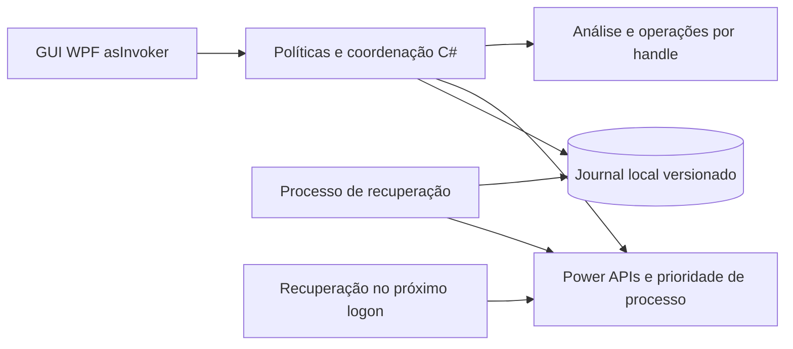

# Especificação vigente — produto local, sem GPN

Versão 2.1 · Implementação 0.1.1.

Esta revisão substitui a proposta original por solicitação do usuário. GPN, servidores de tráfego, multipath, custos de infraestrutura de rede e driver de captura foram retirados. A proposta histórica está em `docs/archive/ESPECIFICACAO_ORIGINAL_COM_GPN.md` apenas para rastreabilidade.

## 1. Viabilidade

Cleaner e Booster funcionam localmente. Limpeza recupera espaço após exclusão, não implica ganho de FPS. Perfis opcionais podem melhorar ou piorar o comportamento; nenhum ganho é garantido. APIs recusadas por políticas do Windows ou processos protegidos não são contornadas.

## 2. Premissas e limites

Windows 11 x64 e volume local NTFS para limpeza. Interface sem solicitar elevação, por usuário, sem backend, conta, telemetria ou driver. Somente arquivos `.tmp`/`.temp` do Temp local com mais de 7 dias entram na análise. Limite de 2.000 candidatos/50.000 entradas por análise, profundidade 12, plano válido por 10 minutos. Quarentena limitada a 2 GiB, nunca purgada automaticamente. Não há limpeza de credenciais, sessões, saves, configurações, caches de jogos, Prefetch, pagefile ou Registro.

## 3. Tecnologia

C#/.NET 10, WPF e interop Win32. Processamento de rede/Rust e serviço SYSTEM são desnecessários após remoção da GPN. Persistência JSON versionada e atomicamente substituída, protegida pela conta do usuário e mutex entre processos; operações registram intenção durável antes de executar. Não há banco/servidor externo nem dependências NuGet de terceiros. UI em português, estilo escuro com suporte ao alto contraste do sistema.

## 4. Arquitetura

O watchdog é outro processo do mesmo executável, com token do mesmo usuário. Não é um serviço privilegiado. Observa identidade PID+hora de criação do processo pai e restaura apenas os ajustes de seu proprietário. GUI e recuperação usam o mesmo mutex de persistência. A interface não aceita comandos remotos.

## 5. Fluxos críticos

### Cleaner

Analisar → exibir prévia → seleção explícita → confirmar → revalidar idade/identidade → registrar intenção → mover por handle → confirmar no journal. Quarentena e original devem estar no mesmo volume, pois a operação é rename, sem cópia seguida de exclusão. Volume diferente falha sem exclusão do original.

Todos os ancestrais são abertos sem seguir reparse e mantidos bloqueados contra substituição durante a operação. Arquivo mutante é aberto exclusivamente; a identidade inclui volume, FileId, tamanho, data de alteração e número de links. Não há `Directory.Delete` recursivo nem exclusão por string de caminho após validação. Destino de restore usa rename sem sobrescrita. Falha de compartilhamento/acesso resulta em ignorar, sem tomar posse ou forçar desbloqueio.

Purgar é ação separada e irreversível, por item selecionado, com confirmação. O tamanho mostrado é lógico, não um benchmark de blocos físicos recuperados. Operações interrompidas deixam estado preparado para reconciliação.

### Booster

Cadastrar executável e hash → escolher opções → salvar → detectar processo correspondente → confirmar ou autorizar automação → garantir watchdog → registrar estado anterior → aplicar → verificar. Nunca Realtime/High. AboveNormal só parte de Normal; outra prioridade existente é preservada.

Plano de energia: apenas selecionar um GUID existente; não alterar índices OEM, CPU ou PCIe. Aplicar só em AC. Entrada temporária HKCU Run é registrada antes de mudar o plano e removida depois da restauração. Recuperação após reboot acontece no próximo logon, não no boot antes de usuário entrar.

Encerramento do jogo, saída da GUI e watchdog acionam restauração. Mudança para bateria restaura o plano. Valor externo diferente do aplicado gera conflito e é preservado. O usuário pode manter o valor atual e encerrar o conflito. A comparação não detecta A→B→A. Apenas um perfil pode manter alterações pendentes.

## 6. Dados

`%LOCALAPPDATA%\SoftwareGamer\state.json`: `SchemaVersion`, perfis, alterações, quarentena e contador lógico de purga. Não apagar enquanto houver pendências. Sem TTL destrutivo automático; limpeza do histórico será decisão futura. Perfis, caminhos e diagnósticos não são enviados. A consulta opcional de atualizações utiliza a API pública do GitHub, que recebe o IP e a versão do app.

`GameProfile`: ID, nome, caminho, SHA-256, AboveNormal, GUID opcional do plano.

`ChangeRecord`: ID, sessão/processo, proprietário/instância da GUI, tipo, recurso, before/applied, estado, detalhe e data. Estados preparados/aplicados/conflitos permanecem elegíveis à revisão; restaurados/liberados são históricos.

`QuarantineRecord`: ID aleatório, raiz original, caminho original, nome opaco armazenado, identidade, estado e data. Intenções de mover/restaurar/purgar são registradas antes das operações. Não reutilizar um journal com versão de schema desconhecida. Corrupção bloqueia mutações; não reconstruir valores padrão.

## 7. Contratos locais

Não há API remota nem pipe privilegiado. Entradas especiais internas: `--watchdog <pid:ticks> <eventName>`, `--recover`, `--uninstall-recover`. O evento local confirma prontidão do watchdog antes de aplicar. Nenhum modo eleva privilégio.

Serviços C#: `CleanerService.Scan/Quarantine/Restore/Purge/Reconcile`, `BoosterService.Apply/RestoreAll/RestoreOne/KeepCurrent/ReconcileRunning`. Arquivos são recebidos como candidatos de análise com snapshot, não como comandos genéricos de exclusão. UI não permite raiz arbitrária; parâmetros de raiz existem apenas para fixtures de teste.

Erros de acesso, arquivo ocupado, identidade alterada, análise expirada, conflito e limite de quarentena interrompem a operação correspondente. Operação parcial é informada; erro de acesso não habilita privilégio adicional.

## 8. APIs Windows

| API | Finalidade e limite |
|---|---|
| CreateFileW / GetFileInformationByHandle / GetFinalPathNameByHandleW | Identidade e handles; rejeitar reparse, hardlink, readonly e caminho divergente |
| SetFileInformationByHandle | Rename sem sobrescrita e disposição de exclusão do mesmo handle |
| PowerEnumerate / PowerReadFriendlyName / PowerGetActiveScheme / PowerSetActiveScheme | Enumerar, selecionar e restaurar planos existentes; sem privilégio forçado |
| Process.StartTime / MainModule / PriorityClass | Instância do processo, caminho e prioridade; acesso negado é respeitado |
| GetSystemPowerStatus / GlobalMemoryStatusEx | Energia e RAM; não inferir temperatura ou FPS |
| HKCU Run | Recuperação temporária de energia no próximo logon; estado anterior ausente é registrado |
| Mutex / EventWaitHandle | Serialização de journal e handshake local do watchdog |

Referências primárias: [arquivos](https://learn.microsoft.com/en-us/windows/win32/api/fileapi/nf-fileapi-createfilew), [operações por handle](https://learn.microsoft.com/en-us/windows/win32/api/fileapi/nf-fileapi-setfileinformationbyhandle), [planos de energia](https://learn.microsoft.com/en-us/windows/win32/power/managing-power-schemes), [prioridade](https://learn.microsoft.com/en-us/windows/win32/api/processthreadsapi/nf-processthreadsapi-setpriorityclass). Consulta em 23/10/2026.

## 9. Segurança, estabilidade e compatibilidade

Não solicitar elevação. Aceitar permissões herdadas sem bloquear a abertura e validar SID/sessão antes de acessar processos. Não existe interface genérica de shell/Registro. Não injetar em jogos, abrir sua memória ou desativar proteções. Perfis identificam executáveis por hash e caminho; atualização do jogo exige recadastro. Administrador ou malware executando como o mesmo usuário não são considerados isolados pelo aplicativo.

Binários iniciais não assinados comercialmente. Checksums e distribuição pelo repositório identificam artefatos, mas não substituem Authenticode. Verificação opcional de versões ao abrir e a cada 6 horas, com confirmação antes de abrir a página oficial. Download e instalação manuais; sem execução automática de artefatos. Desinstalação verifica pendências antes de remover executável e preserva dados locais. Assinatura, testes em Windows 11 físico e homologação anti-cheat permanecem gates de produção.

## 10. Validação

Testes de política e persistência em Linux/Windows; testes Win32 em runner Windows isolado; fixture temporária própria para cada teste. Abranger arquivo ocupado/alterado, hardlink, symlink, troca de ancestral, restauração sem sobrescrita, orçamento de quarentena e conflitos de prioridade em processo filho de teste. Renderizar cinco telas de WPF com dados fictícios e registrar screenshots. Build com warnings como erros.

Não publicar benchmark fictício. FPS/frametime e temperatura aparecem como indisponíveis. Testes físicos pendentes devem comparar padrão versus perfil em cena reproduzível, AC/DC, concorrência e hardware variado; medir CPU/RAM, crashes, frametime percentis e consumo, sem assumir ganho.

## 11. Roadmap

1. Versão 0.1: implementação local, testes automatizados, executável portátil e instalador.
2. Validação em PCs Windows 11 físicos: instalação/remoção, energia real, crash/reboot, DPI/teclado/Narrator e jogos prioritários.
3. Correções e revisão de segurança independente conforme achados.
4. Assinatura comercial e distribuição de produção após aprovação dos gates.
5. Evoluções somente com evidência: novos adaptadores de limpeza, medição de frametime e atualização autenticada. GPN não faz parte desse roadmap.

## 12. Custos

Sem servidores GPN, tráfego contratado, driver próprio ou infraestrutura obrigatória de backend. Permanecem tempo de desenvolvimento/manutenção, ferramentas opcionais, computadores/licenças de teste, CI conforme franquia, assinatura comercial e avaliações externas. Não há compra ou contratação automática pelo app.

## 13. Decisões e pendências

ADR local: remover serviço privilegiado e Rust reduz complexidade porque não há mais captura/encaminhamento. JSON atende ao estado pequeno da versão inicial; nova escala/histórico pode exigir migração. Restauração de energia deve estar pronta antes de aplicar; não habilitar ajustes que dependam de elevação. Prefetch/pagefile/Registro genérico/Standby List são exclusões de produto, não tarefas pendentes.

Pendências para produção: testes reais, assinatura comercial, homologação dos jogos e acessibilidade ampliada. Histórico com GPN não autoriza sua reintrodução. Consulte o guia e as limitações antes de distribuir esta versão como produto final homologado.
