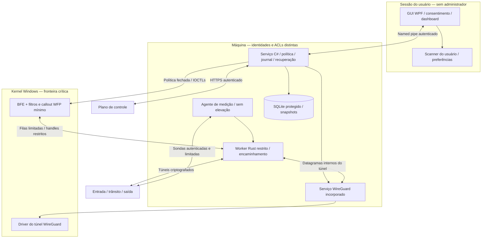
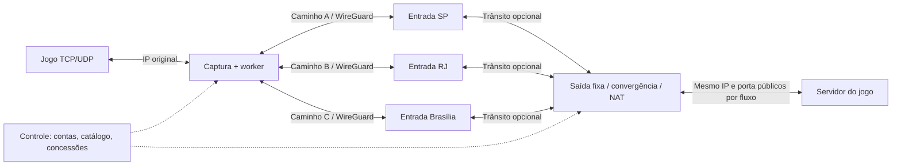
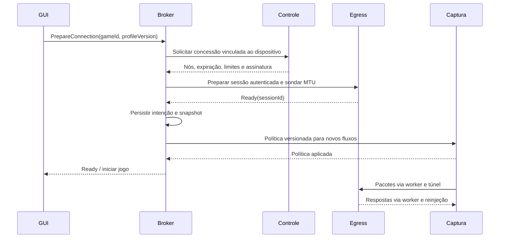
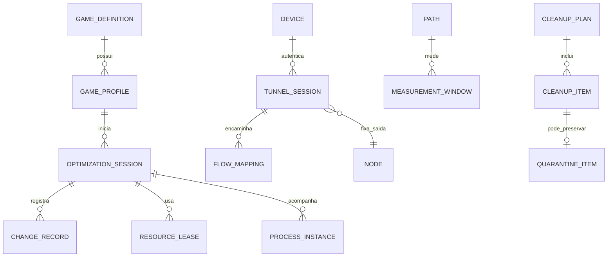

# Especificação técnica — Software Gamer para Windows 11

Versão 1.0 · Consulta das fontes: **23 de outubro de 2026** · Estado: proposta de arquitetura para revisão e orçamento.

Este documento define o produto, suas interfaces, provas de conceito e critérios de entrega. Não constitui implementação nem comprovação de desempenho. Números identificados como metas ou hipóteses são parâmetros iniciais de engenharia, não resultados medidos. As referências são fontes primárias; documentação histórica não é tomada como garantia de comportamento em uma versão atual do Windows.

## 1. Parecer de viabilidade

**Viável como produto condicionado a validação, com maior risco e custo concentrados na GPN.** Cleaner e Booster podem ser entregues independentemente da rede remota. A GPN pode melhorar determinados trajetos; também pode piorar latência, consumir mais banda ou não ter efeito. Não existe fundamento para prometer ganho universal de FPS, menor ping em todos os jogos, ausência de perda ou compatibilidade irrestrita.

| Capacidade | Classificação | Decisão e condição de entrega |
|---|---|---|
| GUI sem elevação, serviço privilegiado, IPC autenticado, inventário e histórico | Suportada por mecanismos documentados | Implementar com separação de privilégios e testes de autorização |
| Limpeza seletiva de temporários | Implementável | Regras restritas, análise prévia, consentimento e proteção por handles; não prometer FPS |
| Planos de energia e prioridade de processo | APIs suportadas; benefício não demonstrado | Disponibilizar apenas opções reversíveis, com comparação por jogo |
| Medir RTT/perda até infraestrutura própria | Implementável | Identificar claramente os pontos medidos |
| Medir perda/latência real de qualquer jogo UDP sem cooperação | Não universalmente possível | Exibir indisponível quando não houver protocolo observável ou telemetria autorizada |
| Capturar somente os fluxos de um jogo | Implementável em princípio; integração exige PoC | WFP como direção de produção; validar primeiro pacote, UDP, auxiliares e coexistência |
| Túnel criptografado e saída com NAT estável | Implementável | Reutilizar protocolo consolidado e manter afinidade por sessão |
| Trocar entrada/trânsito mantendo a mesma saída | Hipótese validável | Preservar identidade interna e estado de tradução na saída |
| Trocar saída pública ou migrar uma conexão direta existente para GPN | Continuidade não garantida | Normalmente exige reconexão; não fazer silenciosamente durante partida |
| Dois ou três caminhos com duplicação/deduplicação | Experimental | Só após demonstrar benefício sobre o melhor caminho único e contabilizar banda |
| Stripe por pacote ou FEC | Experimental fora do MVP | Reordenação, atraso e overhead podem superar o benefício |
| Limpeza de Prefetch, pagefile, Registro genérico e Standby List periódica | Excluída | Sem justificativa para comportamento de produto; risco de regressão ou perda |
| Realtime, desativar segurança, injetar código, manipular memória ou evadir anti-cheat | Excluída | Não integra produto, diagnóstico nem procedimentos de suporte |

WFP diferencia configuração em modo usuário de processamento que requer callout em kernel. WinDivert permite desvio de pacotes, mas não entrega PID em sua camada NETWORK. Esses fatos impedem tratar uma biblioteca de captura como solução pronta de roteamento por jogo. [WFP: critérios para callouts](https://learn.microsoft.com/en-us/windows-hardware/drivers/network/callout-driver-programming-considerations), [WinDivert](https://reqrypt.org/windivert-doc.html).

## 2. Premissas e limites do produto

1. Público inicial: jogadores no Brasil; Windows 11 x64 em versões e edições ainda suportadas. Baseline inicial de homologação: 25H2 atualizado. ARM64, Windows Server e builds Insider ficam fora do MVP. A lista de builds aceitas será versionada; não basta testar a marca “Windows 11”. A edição Home/Pro 24H2 encerrou atualizações em outubro de 2026 e não deve ser o baseline de um lançamento novo. [Ciclo de vida](https://learn.microsoft.com/en-us/lifecycle/products/windows-11-home-and-pro).
2. Instalação por máquina exige administrador. Uso cotidiano da GUI não. Usuários padrão só executam operações previamente permitidas pela política instalada e limitadas à sua sessão/identidade.
3. MVP: um jogo ativo, uma saída fixa e um caminho de dados ativo por sessão; outros caminhos podem receber sondas. Sem VPN de propósito geral, anonimato ou alteração global do DNS.
4. Catálogo inicial de 3–5 jogos homologados, com versões de executáveis e anti-cheats registradas. Auxiliares são incluídos explicitamente; descendência de processo, nome do arquivo e porta não bastam como autorização.
5. IPv4 e IPv6 fazem parte da PoC. A primeira beta GPN só sai se encaminhar ambos corretamente ou identificar e manter diretamente, com aviso, os fluxos de uma família não suportada. Nunca desativar IPv6 do Windows como solução.
6. P2P, hospedagem de partidas, multicast, broadcast, tráfego LAN, NAT traversal peculiar, VPN corporativa e sobreposição com outra VPN exigem homologação adicional. Downloads de jogos ficam diretos por padrão.
7. São Paulo, Rio de Janeiro e Brasília são **candidatas** a pontos de presença. Cidade, ASN, provedor, peering, upstream e rota de retorno precisam ser medidos. Não está confirmada disponibilidade comercial nas três cidades.
8. Cleaner/Booster funcionam offline. GPN depende de assinatura/autenticação, servidores, contratos de trânsito, IPv4/IPv6, mitigação de abuso e operação contínua. Falha do plano de controle não interrompe imediatamente sessões já autorizadas.
9. Toda configuração persistente possui snapshot anterior e restauração individual/global. Exclusão de arquivos é uma operação destrutiva separada: só pode ser oferecida com indicação explícita de irreversibilidade; quarentena preserva restauração enquanto existir. “Restaurar tudo” não recria arquivos purgados.
10. Não encerrar aplicativos, forçar exclusão de arquivos em uso, desativar serviços de segurança ou alterar configurações gerenciadas por GPO/MDM. Temperatura de CPU/GPU pode estar indisponível sem API suportada do fabricante; não adicionar um driver genérico de acesso a hardware para obtê-la.

## 3. Escolha tecnológica justificada

### 3.1 Comparação

| Alternativa | Produtividade e Windows | Recursos e rede | Distribuição/manutenção | Parecer |
|---|---|---|---|---|
| C# + .NET 10 + WPF | Ecossistema maduro, MVVM, acessibilidade, integração Win32 por P/Invoke | GC exige cuidado em caminhos críticos; GUI não deve processar pacotes | Instalador por máquina, runtime próprio ou dependência mantida; Fluent disponível | Melhor equilíbrio para produto Windows e equipe C# |
| C# + .NET 10 + WinUI 3 | Controles modernos e integração visual direta | Também gerenciado; não elimina driver nem serviço | Windows App SDK tem ciclo e empacotamento adicionais a manter | Boa alternativa se equipe já domina WinUI; benefício visual não justifica migrar a decisão inicial |
| Rust + Tauri 2 | Boa reutilização de frontend web; Win32 exige FFI e experiência específica | Rust facilita controle de alocação; memória total inclui WebView2 e frontend | Atualizações do app, dependências web e WebView2; capabilities/CSP necessárias | Atraente para equipe Rust/web; não há garantia automática de RAM menor |
| C# na aplicação + Rust em processo de rede + callout mínimo C/C++ | Mantém produtividade da GUI e isola processamento nativo | Sem GC no loop de encaminhamento próprio; falhas do worker não corrompem heap da GUI | Mais linguagens, contratos e pipelines; kernel continua sendo componente de risco | **Escolhida**, condicionada à capacidade da equipe e gates de captura |

**Decisão:** .NET 10 LTS, WPF/MVVM na GUI e serviço de política; Rust estável com toolchain fixada no worker de encaminhamento/medição e nos relays; C/C++ com WDK somente no callout WFP mínimo. Linux suportado nos nós; ASP.NET Core no controle; PostgreSQL no servidor e SQLite local. Evitar adicionar Rust ao Cleaner/Booster sem necessidade.

.NET 10 está suportado na data de consulta, com horizonte LTS até novembro de 2028. Usar o patch suportado vigente no build e prever atualização mensal; não começar projeto novo em .NET 8/9 próximos do fim de suporte. WPF já possui tema Fluent; o ciclo do Windows App SDK seria uma dependência extra para WinUI. [Política .NET](https://dotnet.microsoft.com/en-us/platform/support/policy), [Fluent no WPF](https://learn.microsoft.com/en-us/dotnet/desktop/wpf/whats-new/net90), [Suporte do Windows App SDK](https://learn.microsoft.com/en-us/windows/apps/windows-app-sdk/support), [Capabilities do Tauri](https://v2.tauri.app/security/capabilities/).

O benefício da arquitetura híbrida é isolamento e controle de memória no dataplane, não uma alegação prévia de superioridade de desempenho. Se o benchmark demonstrar que um worker C# satisfaz integralmente o orçamento e a equipe não sustentar Rust, registrar ADR substituindo-o antes da beta. Manter IPC estável permite essa troca.

### 3.2 Interface e distribuição

GUI Fluent com tema claro/escuro, contraste alto, navegação por teclado, UI Automation/Narrator, escalas 100–200% e respeito a redução de movimento/transparência. Mica/Acrylic somente quando suportados pela combinação de Windows e composição; fallback sólido obrigatório. Não inserir overlay no processo do jogo.

Dashboard deve mostrar:

- estado: direto, preparando, GPN ativa, degradada, aguardando reconexão ou erro;
- entrada, trânsito, saída pública e motivo/data da última mudança;
- RTT p50/p95/p99, jitter definido, perda e janela; selo “até saída GPN”, “destino cooperativo”, “estimativa” ou “indisponível”;
- banda útil, encapsulamento, duplicação/FEC e total físico, separadamente em upload/download;
- espaço analisado, elegível, em quarentena e efetivamente liberado;
- ajustes ativos, proprietário do ajuste, conflitos e botões de restauração individual/global.

Instalador MSI/bundle assinado em diretório protegido, bootstrapper elevado apenas para instalar serviço/driver. Runtime .NET self-contained inicialmente para previsibilidade, aceitando tamanho maior e obrigação de atualizá-lo junto ao app. Não presumir que MSIX/Store resolva a instalação de driver. Atualização de dados do catálogo não pode distribuir scripts executáveis.

## 4. Arquitetura de componentes e implantação

### 4.1 Componentes e limites de confiança



| Componente | Identidade/privilégios | Prioridade e justificativa |
|---|---|---|
| GUI e scanner pessoal | Token do usuário; sem credenciais de serviço | Normal; scanner BelowNormal/background, pausado em jogo |
| Broker | Serviço com SID próprio; LocalSystem somente para operações que efetivamente precisarem, privilégios removidos/desabilitados quando desnecessários | Normal; não participa do loop por pacote |
| Worker de rede | Conta virtual/LocalService restrita; só handles concedidos de filas e sockets | Normal inicialmente; avaliar aumento de threads específicas após medir filas; nunca Realtime |
| Agente de medição | Identidade restrita; destinos de sonda autorizados | Normal com timers econômicos; sem busy-wait |
| Serviço WireGuard | Privilégios exigidos pela integração oficial; interface administrativa somente ao broker | Padrão da implementação, sem tuning global |
| Driver WFP | Kernel; IOCTLs somente ao SID do broker e handles mínimos ao worker | Respeitar IRQL e callbacks; nenhuma operação bloqueante ou alocação ilimitada |
| Updater | Staging sem elevação; instalador privilegiado temporário com comandos fixos | BelowNormal fora de partidas; não substituir driver em uso |
| Relays e controle | Usuários de serviço separados; capabilities Linux mínimas para TUN/NAT | Scheduler normal; otimização por evidência de perf/filas |

O broker não deve carregar parsers de pacotes vindos da Internet. Separar plano de controle do plano de dados limita exposição, mas um worker comprometido ainda pode abusar do tráfego autorizado: driver e saída precisam validar limites independentemente.

### 4.2 Captura e identificação

| Alternativa | Usuário/kernel | Identificação e limitações | Decisão |
|---|---|---|---|
| WFP | Gerenciamento `Fwpm*` em usuário; callouts `Fwps*` em kernel | ALE fornece contexto de aplicação; camadas de transporte não herdam automaticamente toda informação de ALE. Exige contexto por fluxo e tratamento de UDP | Direção de produção; driver mínimo, sujeito à PoC e assinatura |
| WinDivert | API/DLL em usuário e driver WFP próprio em kernel | FLOW/SOCKET têm PID; NETWORK captura pacotes sem PID. Eventos antigos não são recuperados pelo handle FLOW. Correlação pode ter corrida | Acelerar laboratório; não assumir elegibilidade para distribuição ou anti-cheat |
| Adaptador TUN/Wintun/WireGuardNT | Interface virtual com driver e consumidor em usuário ou kernel | Rotas IP não distinguem processos; selecionar apenas IP do servidor pode capturar outro app | Transporte complementar; não resolve seleção por processo |
| Proxy SOCKS/HTTP | Usuário; captura transparente pode exigir WFP | Jogos geralmente não oferecem configuração; UDP e auxiliares variam | Somente jogos que suportem proxy explicitamente |
| VPN do Windows/per-app gerenciada | Recursos e políticas dependem da plataforma/gerenciamento | Não presumir que per-app VPN gerenciada esteja disponível para qualquer jogo Win32 consumidor | Investigar apenas em edição empresarial futura |
| NDIS LWF ou captura pcap | Driver adicional de baixo nível | Não soluciona identidade de processo por si; amplia superfície e complexidade | Fora do produto inicial |
| LSP/TDI/injeção | Mecanismos legados ou incompatíveis com princípios | Custo de compatibilidade e técnicas desnecessárias | Descartados |

WFP documenta redirecionamento de conexão para proxy, mas isso muda a arquitetura: um proxy TCP termina duas conexões e não é equivalente ao túnel L3 transparente aqui escolhido. Não usar esse caminho como prova de que UDP arbitrário e continuidade estão resolvidos. [Camadas ALE](https://learn.microsoft.com/en-us/windows/win32/fwp/ale-layers), [Redirecionamento](https://learn.microsoft.com/en-us/windows-hardware/drivers/network/using-bind-or-connect-redirection), [Migração e mecanismos legados](https://learn.microsoft.com/en-us/windows-hardware/drivers/network/porting-packet-processing-drivers-and-apps-to-wfp).

**Identidade proposta:** `ProcessInstance = bootId + PID + creationTime + userSID + executableIdentity`; manter handle do processo quando possível, nunca confiar apenas em PID. Catálogo inclui caminho canônico, publisher/hash conforme versão e auxiliares autorizados. Reinício cria nova instância e reavalia perfil. Falha de identificação deixa o fluxo direto, com diagnóstico.

**Fluxo:** chave contém instância de processo, família, protocolo, endereços/portas, compartment/interface quando necessário e identificador ALE/endpoint. UDP não conectado exige mapear múltiplos destinos de um mesmo socket; binds compartilhados e reutilização de porta precisam ser testes próprios. Identificar apenas por 5-tupla é insuficiente em todos os cenários. As tabelas IP Helper servem a inventário/reconciliação, não à decisão atômica do primeiro pacote; a tabela UDP lista endpoints locais, não fornece uma lista completa de pares remotos. [TCP](https://learn.microsoft.com/en-us/windows/win32/api/iphlpapi/nf-iphlpapi-getextendedtcptable), [UDP](https://learn.microsoft.com/en-us/windows/win32/api/iphlpapi/nf-iphlpapi-getextendedudptable).

**Política por fluxo:** decidir direto/GPN antes de encaminhar o primeiro pacote e fixar essa decisão. Abrir o jogo depois de o túnel estar pronto é o caminho recomendado. Fluxos preexistentes continuam diretos até reconectar. Não deixar sair o primeiro pacote direto e transportar os seguintes pela GPN.

**Loops:** excluir identidade do worker/WireGuard, sockets de controle, endereços dos peers e interfaces do túnel; instalar somente rotas restritas para endpoints internos, nunca rota default global. Reinjeção própria usa o estado de injeção WFP; tráfego de outro fornecedor não pode ser descartado só por estar reinjetado. Tratar checksums/offload, ICMP, fragmentos, IPv6 extension headers e scope IDs. Mudança de interface invalida medições, rotas externas e MTU, não a identidade lógica da sessão. [Reinjeção WFP](https://learn.microsoft.com/en-us/windows-hardware/drivers/network/packet-injection-functions).

### 4.3 Túnel e encaminhamento remoto

| Tecnologia | Adequação | Limitação | Decisão |
|---|---|---|---|
| WireGuard | Túnel IP sobre UDP, criptografia e renovação de chaves consolidadas; integração Windows documentada | Não fornece catálogo, login comercial, captura por processo ou deduplicação multipath do produto | Primeira opção da PoC |
| IKEv2/IPsec | Padrão estabelecido e integração Windows | Política por processo e coordenação de caminhos continuam difíceis; complexidade de implantação | Alternativa se WireGuard falhar em requisitos concretos |
| QUIC DATAGRAM / MASQUE | Transporte autenticado, datagramas e congestion control; integração com serviços HTTP | Novo trabalho de túnel, filas e comportamento de congestionamento; não é “UDP sem custo” | Segunda PoC se integração/MTU/operabilidade justificar |
| OpenVPN UDP | Solução estabelecida | Benchmark de overhead e licenças; não resolve multipath do produto | Alternativa de comparação, sem manter dois stacks no MVP |
| Túnel confiável sobre TCP | Pode atravessar algumas redes restritas | Head-of-line e interação com TCP interno; ruim para datagramas de baixa latência | Não usar como fallback automático para partidas |
| Criptografia/protocolo seguro próprios | Nenhum benefício demonstrado | Auditoria, replay, handshake, rotação e manutenção | Descartados |

WireGuard oferece integração de serviço para Windows e recomenda essa camada em vez do uso direto de WireGuardNT. QUIC DATAGRAM é não confiável, mas sujeito ao controle de congestionamento; CONNECT-UDP não é captura transparente por processo. [Embedding WireGuard](https://www.wireguard.com/embedding/), [RFC 9221](https://www.rfc-editor.org/info/rfc9221/), [RFC 9298](https://www.rfc-editor.org/rfc/rfc9298.html).

**Composição proposta para PoC:** o callout entrega o pacote IP selecionado ao worker; o worker coloca-o em um frame de encaminhamento versionado e envia um datagrama a um endpoint interno acessível pelo WireGuard. Entrada e saída são co-localizadas no MVP. Quando houver trânsito, o relay encaminha esses frames por outro enlace WireGuard ao mesmo egress. Na saída, o frame é validado e o pacote IP entra numa interface/namespace isolado, com NAT e conntrack por sessão/tenant. A resposta percorre o caminho inverso e é reinjetada no cliente.

Esse envelope é um **formato de encaminhamento**, não criptografia própria. É necessário para transportar identidade de sessão, separar endereços privados sobrepostos e futuramente identificar duplicatas. Seu custo de cópia/MTU deve competir com uma implementação simples de túnel sem multipath. Não usar “WireGuard suporta multipath” como justificativa: o recurso pertence ao overlay proposto.

Cada caminho usa endpoints internos/peers ou interfaces distintos, sem rotas AllowedIPs ambíguas. No MVP, um peer ativo. Em PoC multipath, até três túneis independentes com identificação do caminho. O relay de entrada é uma fronteira confiável e pode observar dados internos após decapsulação; não prometer criptografia cliente–egress exclusiva quando houver terminação em cada salto. O tráfego do egress até o jogo mantém a proteção nativa do jogo, se existir.

**Chaves e autorização:** usar protocolo WireGuard sem alterações, incluindo autenticação, AEAD e defesa de replay. Chave privada do dispositivo gerada localmente; registrar somente a pública no controle. Associar peer a tenant, destinos, quota e validade por concessão assinada. Rotação de chaves de transporte é do protocolo; rotação da identidade estática é operação coordenada com sobreposição curta e revogação. Segredos nunca aparecem na GUI/logs. [Protocolo WireGuard](https://www.wireguard.com/protocol/).

**MTU:** calcular por caminho `MTU útil = PMTU externa − cabeçalhos externos − WireGuard − UDP/IP internos − frame`; não fixar universalmente 1.420 bytes. WireGuard acrescenta tipicamente 60 bytes com IPv4 externo ou 80 com IPv6, antes do envelope adicional e eventual padding. Medir pacote real. Usar sondas autenticadas de tamanhos crescentes e confirmação conforme DPLPMTUD; permitir ICMP Packet Too Big/Fragmentation Needed validado. [RFC 8899](https://www.rfc-editor.org/info/rfc8899/).

Não depender de fragmentação IP externa. TCP interno pode usar MSS compatível com orçamento validado, sem terminar TCP; cobrir IPv6 e opções. UDP maior exige política explícita: fragmentação **do frame** em laboratório, reassembly limitado a 64 KiB por pacote, no máximo 64 fragmentos e timeout inicial de 50 ms, com teto de memória por sessão; descartar a unidade incompleta. Se essa implementação não passar, declarar tamanho/família não suportados antes de iniciar o fluxo. Especialmente, uma PMTU externa pequena não permite anunciar IPv6 interno abaixo do mínimo de 1.280 bytes como solução. Não migrar um fluxo vivo para direto por um pacote grande.

**NAT e sessões:** CGNAT do cliente é tratado por transporte iniciado de dentro para fora; mapear a saída com identidade estável por fluxo. Candidato de keepalive: 25 s somente quando houver necessidade de manter NAT em ociosidade; ajustar por testes, sem tráfego redundante em atividade. NAT UDP no egress: timeout inicial 120 s, renovado por tráfego legítimo; manter sessão de controle não mantém automaticamente cada mapeamento UDP. TCP segue estado/fechamento do conntrack e limites configurados. Reutilizar mapeamentos apenas sob a mesma sessão autenticada; nunca recriar estado TCP perdido fingindo continuidade.

**Abuso:** peers não são proxies públicos. Rate limit por dispositivo/conta/IP, limites de pps/fluxos, origem interna vinculada ao peer, destinos/portas autorizados pelo catálogo e bloqueio de destinos privados, link-local, metadata cloud e SMTP. DNS para infraestrutura fica separado de destinos encaminhados. Validar respostas/endereços antes de sondas grandes; não responder com amplificação a pedidos anônimos. Aplicar proteção no host e contratar upstream contra ataques volumétricos. Proibir que regra de jogo vire túnel irrestrito para qualquer porta.

### 4.4 Implantação e percurso de ida e volta



Setas bidirecionais representam ida **e retorno**: a saída remove a tradução reversa, o overlay escolhe o caminho de retorno, o cliente deduplica e reinjeta. Um percurso lógico pode conter entrada e saída no mesmo servidor. Três cidades não significam três rotas independentes; medir ASN, compartilhamento do acesso residencial e correlação de perdas.

Controle em pelo menos duas instâncias na beta, banco com backup e recuperação testada, distribuição de catálogo assinada. Relays sem estado persistente de payload; egress mantém estado volátil de sessões/conntrack. Não usar balanceamento UDP aleatório entre egresses. Affinity, drenagem e capacidade sob falha vêm antes de autoscaling. HA de estado com mesmo endereço público/BGP é projeto separado e não promessa do MVP.

Observabilidade dos nós: pps/bytes por sentido, CPU/steal, memória, fila e atraso de encaminhamento, drops por motivo, idade do handshake, sessões/fluxos, ocupação de conntrack/portas NAT, MTU, deduplicatas, fragmentos expirados e custo por enlace. Métricas exportadas em agregados, sem payload; cardinalidade por fluxo fica no diagnóstico local limitado. Health de admissão separado de health de sessão: nó em drenagem recusa sessões novas e mantém antigas. Alertar quando houver exaustão de portas, aumento de fila, perda interna ou divergência entre contador físico e faturamento; controle indisponível não deve reiniciar relays saudáveis.

### 4.5 Multipath e continuidade

| Estratégia | Como opera | Benefício possível | Risco/decisão |
|---|---|---|---|
| Duplicação | Mesmo pacote enviado em 2–3 caminhos; primeira cópia válida vence | Reduzir cauda/perda quando caminhos divergem e banda sobra | Duplica/triplica tráfego do trecho replicado; não ajuda falha comum; PoC posterior |
| Distribuição por fluxo | Fluxos diferentes fixados em caminhos diferentes | Distribuir carga com menos reordenação | Um fluxo isolado não ganha diversidade; possível fase futura |
| Distribuição por pacote | Pacotes de um fluxo alternam caminhos | Agregar capacidade | Reordenação, jitter e retransmissões; fora do MVP |
| FEC | Dados + símbolos redundantes, sem retransmissão de todos | Recuperar perdas específicas dentro de deadline | Espera por bloco, CPU e banda; hipótese separada, implementação consolidada |

**Identificação:** envelope autenticado pelo túnel contém `version, sessionId, epoch, flowId, direction, packetSeq, pathId, fragmentIndex/count, payloadLength`. `packetSeq` de 64 bits avança por fluxo e direção; todas as cópias compartilham sequência e epoch. Nova sessão muda epoch aleatório. Deduplicar **antes de encaminhar ao jogo** no egress e **antes de reinjetar** no cliente. Replay de cada WireGuard não substitui deduplicação entre túneis diferentes.

Janela inicial: bitmap de 4.096 sequências por fluxo/direção, limite agregado e expiração de 2 s; validar contra taxa de pacotes e diferença de atraso. Recusar IDs desconhecidos, duplicatas fora da janela e fragmentos inconsistentes. Não deduplicar por hash do conteúdo: pacotes legítimos iguais podem existir. Para frames fragmentados, reconstruir uma vez e deduplicar a unidade lógica.

UDP: duplicação entrega a primeira unidade completa sem esperar o caminho lento; não acrescentar confiabilidade/retransmissão universal. Um buffer de reordenação de 0–5 ms só por perfil validado; esperar demais derrota a baixa latência. TCP: preservar TCP ponta a ponta e nunca duplicar a conexão; duplicar pacotes no overlay, deduplicando antes da pilha. Reordenação residual pode disparar retransmissões e reduzir janela. Não tratar ACK de transporte como “ping do jogo”.

Limite padrão de experimento: duplicar apenas fluxos homologados, com orçamento adicional configurável de 100% para dois caminhos ou 200% para três, **além do encapsulamento**; nunca habilitar três por padrão. Reduzir duplicação se fila/RTT sobem, há saturação, franquia de dados ou gasto acima do consentido. O controle de banda precisa considerar o gargalo compartilhado, não só capacidade de cada relay.

| Mudança/falha | Continuidade esperada |
|---|---|
| Entrada/trânsito muda, egress e NAT permanecem | Possível com mesma sessão/flowId e retorno atualizado; PoC mede perda transitória |
| Wi-Fi → Ethernet ou novo IP do cliente | Transporte pode recuperar; jogo pode ter socket vinculado ao IP antigo e exigir reconexão |
| Egress reinicia/perde conntrack ou muda IP/porta pública | Reconexão normalmente necessária, mesmo se o controle continuar disponível |
| Túnel → conexão direta | IP/porta de origem vistos pelo servidor mudam; TCP quebra e UDP pode perder sessão |
| Direto → GPN durante partida | Não migrar conexão existente; aplicar aos próximos fluxos/reconexão consentida |

Roaming do túnel não equivale à migração garantida do protocolo do jogo. Preservar o endereço público sem preservar estado de NAT e retorno também não é suficiente.

## 5. Fluxos críticos

### 5.1 Conexão e captura

1. GUI escolhe jogo/perfil; broker valida versão, usuário, licença, build, driver e política de compatibilidade.
2. Medição compara direto e candidatos na mesma classe de evidência; se não houver evidência suficiente, manter direto ou oferecer teste explícito.
3. Controle emite concessão curta vinculada à chave pública do dispositivo, egress, limites e catálogo. Broker prepara túnel/rotas restritas e testa ida/volta/MTU.
4. Registrar intenção no journal, criar filtros dinâmicos e só então marcar GPN pronta. Inicializar política antes de iniciar o jogo; fluxo desconhecido continua direto.
5. Classificação do primeiro pacote fixa direto/GPN. Confirmar que não houve envio duplo direto+túnel. Worker cria flowId no egress e passa a encaminhar com filas limitadas.
6. GUI consome eventos resumidos; fechar a GUI não encerra sessão ativa. Encerrar o jogo remove fluxos, drena filas e inicia restauração do perfil.



Falha do worker remove rapidamente captura para **novos** fluxos. Fluxos GPN existentes não passam silenciosamente a direto: permanecerão indisponíveis até recuperar o mesmo estado ou reconectar. Filtros dinâmicos e watchdog devem evitar bloquear o restante do sistema; mesmo com política fail-open, a sessão do jogo pode cair. O produto é otimizador, não kill switch de privacidade.

### 5.2 Medição e seleção de rotas

**Observáveis distintos:** cliente→entrada; cliente→egress por todo o overlay; egress→destino; cliente→destino por direto/GPN quando houver resposta válida e autorizada. RTT cliente→egress somado a RTT egress→destino é estimativa, não RTT fim a fim medido. Traceroute/ICMP bloqueado não prova perda no tráfego do jogo. Em UDP criptografado sem sequências acessíveis, contagem de pacotes locais não permite inferir perda remota.

Proposta de amostragem: 2 sondas/s no caminho ativo, 0,5/s em cada candidato, no máximo 3 candidatos; burst de preparação 5/s por 5 s. Limite global inicial 20 pacotes de sonda/s e 32 kbit/s físicos, reduzido em bateria/franquia. Destinos de jogo somente se responderem a sondas permitidas; máximo 1/s por destino e respeitar política do fornecedor. Keepalive e MTU também entram no orçamento.

Janela rápida 30 s para degradação; janela de decisão 120 s e pelo menos 60 amostras válidas por candidato. Agregação de 5 min para interface e 15 min para tendências. EWMA α=0,2 para tendência; percentis calculados sobre amostras reais, sem tirar percentil de médias. Jitter operacional = `abs(RTT[i] − RTT[i−1])`, p50/p95, rotulado “variação de RTT”; não chamar de jitter unidirecional RFC sem relógios e medição apropriados.

Perda = sondas sem resposta até timeout / enviadas, com duplicatas separadas. Timeout inicial `max(1 s, 4 × RTT suavizado)`, teto 3 s; respostas tardias são registradas. Publicar n, janela, idade da última amostra e IC95 por Wilson; 0 perdas em 60 sondas **não** demonstra perda zero. Para percentis e comparação, usar bootstrap em blocos/sessões, preservando autocorrelação.

Função candidata, em milissegundos equivalentes, menor é melhor:

`S = RTTp95 + 0,5 × jitterp95 + 10 × perdaPercentualSuperior95 + 20 × overheadFracao + penalidadeIncerteza`

Perda é em **pontos percentuais** (1% → 1), overhead é fração (100% → 1). Pesos são hipóteses a calibrar. Caminhos indisponíveis, sem autorização, saturados, sem MTU compatível ou com medidas vencidas são inelegíveis. Não comparar diretamente pontuações de escopos diferentes; as métricas até egress servem para escolher entrada/trânsito do mesmo egress, não para alegar vitória sobre conexão direta ao jogo.

Histerese inicial: melhora ≥ `max(5 ms equivalentes, 15% do score atual)` por três avaliações a cada 5 s; permanência mínima 60 s; cooldown de 30 s após falha. Falha dura pode dispensar permanência, mas exige alternativa autenticada e saudável. “Sem ganho” é resultado válido.

```text
a_cada_5s(sessao):
    medidas = snapshots_com_escopo_e_janela()
    candidatos = filtrar_autorizacao_mtu_frescor_capacidade(medidas)
    se sessao.tem_fluxos_ativos:
        candidatos = somente_mesmo_egress_e_estado_preservavel(candidatos)
    se falha_dura(atual):
        melhor = melhor_saudavel_comparavel(candidatos)
        se melhor existe: trocar_com_confirmacao_de_retorno(melhor)
        senao: sinalizar_reconexao_e_aplicar_politica_para_novos_fluxos()
        retornar
    se amostras_insuficientes_ou_escopos_incomparaveis: manter(); retornar
    melhor = argmin(score(candidatos))
    ganho = score(atual) - score(melhor)
    se ganho >= max(5, 0.15 * score(atual)):
        incrementar_confirmacoes_do_mesmo_candidato()
    senao: zerar_confirmacoes()
    se confirmacoes >= 3 e permanencia >= 60s e cooldown_expirou:
        preparar_novo_caminho_sem_desativar_antigo()
        confirmar_sessao_mtu_e_retorno_no_egress()
        trocar_e_drenar_antigo_com_deduplicacao()
```

Falha dura: handshake expirado/erro fatal ou três timeouts consecutivos acompanhados de ausência de dados e confirmação de falha por outro sinal. Perda de sondas isolada não encerra partida que ainda recebe tráfego. Sem concessão válida, novas conexões GPN são negadas; sessões existentes só continuam pelo prazo já autorizado, sem extensão arbitrária offline.

### 5.3 Cleaner: categorias, mecanismos e exclusões

Todas as categorias começam desmarcadas na primeira utilização. Scanner apresenta bytes lógicos e estimativa alocada, confiança, idade, quantidade, categoria, risco, restauração e motivo de ignorados. Datas antigas ajudam a filtrar, mas **não provam** dispensabilidade.

| Categoria | Benefício/evidência e mecanismo | Elevação | Bloqueios | Restauração e decisão |
|---|---|---|---|---|
| Temporários do usuário | Recuperar espaço de arquivos abandonados; Known Folder/raiz validada e Win32 por handle; regra inicial ≥7 dias mais exclusões | Não; operar como usuário | Em uso, origem desconhecida, instalador/update ativo, links ou identidade alterada | Quarentena opcional; purga explícita irreversível. MVP restrito |
| Temporários do Windows | Espaço em resíduos comprovados; preferir Armazenamento/Limpeza de Disco; allowlist própria só após homologação | Sim para limpeza administrativa | Windows Update, instalação, reparo ou reinício pendente; acesso negado; cache de instalador | Sem promessa de restauração no mecanismo do SO; categoria guiada no MVP |
| Cache de shaders DirectX | Pode resolver corrupção e liberar espaço; também provoca recompilação e stutter | Depende do mecanismo/local | Jogo/compilação ativos; opção de desempenho automático | Limpeza do Windows guiada, quando exposta; sem garantia de restauração. Opcional para diagnóstico, nunca antes de cada partida |
| Otimização de Entrega | Windows já gerencia cache; limpeza oficial recupera espaço, pode exigir redownload | Usualmente admin para cmdlet; validar build | Download/update ativo, arquivos pinned, gestão empresarial, estado incerto | Irreversível no mecanismo oficial. MVP guiado; cmdlet condicionado a PoC |
| Chrome | Cache de imagens/arquivos pode liberar espaço e corrigir conteúdo obsoleto | Não | Browser/background ativo para adaptador de arquivos; perfil desconhecido; operação que inclua cookies/storage | Usar UI oficial no MVP, apenas cache; reconstrução custa rede/tempo |
| Edge | Mesmo princípio; ação de cache separada de histórico/senhas/cookies | Não | Sincronização/seleção ampla; processos de perfil ativos | UI oficial, somente cache; sem restauração prometida |
| Firefox | Limpar somente conteúdo temporário em cache | Não | Perfil ativo/desconhecido; confusão com dados de sites | UI oficial; excluir cookies, logins, sessões e site storage |
| Steam | Limpeza oficial do download cache é troubleshooting e requer novo login | Não normalmente | Download/update; qualquer perda de sessão | **Não automatizar** por conflito com preservação de sessões; temporários não documentados ficam excluídos |
| Epic Games Launcher | Há procedimento oficial para webcache; pode corrigir UI | Não normalmente | Launcher ativo; não comprovação de separação entre cache e dados de autenticação | Guia opcional; não apagar pasta webcache inteira automaticamente. Adaptador futuro só após validar preservação de sessão |
| Riot Client | Não foi validado mecanismo público estável para limpeza seletiva com preservação de estado | Não no perfil; não elevar para forçar | Cliente/jogo/anti-cheat em atividade ou sem regra documentada | Excluir do MVP; não apagar árvore Riot nem dados de Vanguard |
| Prefetch | Cache de inicialização não é lixo por definição; sem evidência de ganho de jogo por remoção | Normalmente admin | Sempre bloqueado pelo produto | Descartado |
| Pagefile/swapfile | Mecanismo de memória/commit e diagnóstico; apagar/redimensionar pode causar falhas | Admin/reinício podem ser envolvidos | Sempre bloqueado | Descartado; manter gestão do Windows |
| Registro | Entradas “órfãs” não são espaço relevante nem diagnóstico confiável | Variável | Sem regra específica de funcionalidade suportada | Cleaner de Registro genérico descartado |

Windows documenta limpeza de Delivery Optimization pela própria ferramenta; a página do cmdlet consultada possui descrições incompletas. Portanto, existência do comando não basta para certificar pré-condições e efeitos. Não usar `-Force` ou `-IncludePinnedFiles`, nem apagar manualmente os diretórios do serviço. [Limpeza oficial](https://support.microsoft.com/en-us/windows/deployment/updates-lifecycle/delivery-optimization-in-windows), [Cmdlet e lacunas de documentação](https://learn.microsoft.com/en-us/powershell/module/deliveryoptimization/delete-deliveryoptimizationcache?view=windowsserver2025-ps).

Os fornecedores documentam interfaces para limpar cache, não um contrato universal para terceiros apagarem diretórios internos. O MVP usa essas interfaces guiadas quando a automação segura não estiver demonstrada; nesse caso, tamanho/resultado podem aparecer como indisponíveis. [Chrome](https://support.google.com/chrome/answer/2392709/clear-browsing-data-computer?hl=en-GB), [Edge](https://support.microsoft.com/en-us/edge/view-and-delete-browser-history-in-microsoft-edge), [Firefox](https://support.mozilla.org/en-US/kb/how-clear-firefox-cache), [Steam e novo login](https://help.steampowered.com/en/faqs/view/6AD7-820D-8BE5-E51F), [Epic](https://www.epicgames.com/help/en-US/c-Category_EpicAccounts/c-TechnicalSupport_GeneralSupport/a000086158).

**Proteção de arquivos:** plano de limpeza produzido pelo executor, com ID opaco, hash, prazo e itens identificados por volume/FileId; a GUI não envia caminhos arbitrários ao serviço. Descobrir raízes por APIs e configuração confiável, nunca expandir `%TEMP%` fornecido por usuário dentro de serviço SYSTEM. Não seguir reparse points, junctions, symlinks, mount points ou placeholders; excluir hardlinks múltiplos, ADS, dispositivos, UNC e volumes não homologados no MVP.

Percorrer componentes com handles e rejeitar reparse points em **todos** os ancestrais, não só no arquivo final. Manter diretórios relevantes abertos com compartilhamento que impeça sua substituição/renomeação durante a operação; se não conseguir garantir isso, ignorar o item. Abrir o arquivo sem seguir reparse, validar FileId, volume, atributos, tamanho/mtime e caminho final contra o plano; operar por esse mesmo handle. Validar antes de mover/apagar; nunca validar string e depois chamar `DeleteFile` em caminho reaberto. `GetFullPath` e checagem de prefixo isoladas não resolvem TOCTOU. [CreateFileW](https://learn.microsoft.com/en-us/windows/win32/api/fileapi/nf-fileapi-createfilew), [Operação por handle](https://learn.microsoft.com/en-us/windows/win32/api/fileapi/nf-fileapi-setfileinformationbyhandle).

Não assumir que `FILE_FLAG_OPEN_REPARSE_POINT` protege componentes intermediários. A resistência à troca concorrente de ancestral é gate de segurança. Operações pessoais executam sob token do usuário; operações privilegiadas nunca seguem um caminho controlado por ele com autoridade SYSTEM. Não tomar posse, alterar ACL nem habilitar backup privilege para vencer acesso negado.

Fluxo: scan → plano imutável → seleção e consentimento → revalidação → quarentena ou purga → recibo por item. Plano expira em 10 min; arquivo alterado volta a scan. Usar abertura exclusiva adequada para recusar arquivos em uso, inclusive quando o outro processo permitir delete sharing; se o mecanismo oficial do SO gerir cache ativo, delegar a ele sem forçar handles.

Quarentena por volume em pasta privada, rename sem sobrescrita, manifesto de identidade/ACL/metadados, máximo inicial 7 dias ou 2 GiB. Ao atingir limite, parar e pedir decisão no produto; não purgar silenciosamente. Mover no mesmo volume **não libera espaço**. Só contar bytes liberados após exclusão efetiva, distinguindo estimativa de blocos liberados e variação global de espaço livre, que outros processos podem alterar. Restauração recusa sobrescrever arquivo recriado; oferece recuperação para destino alternativo autorizado. Cache reconstruído pode tornar a cópia antiga inadequada: avisar e não restaurar automaticamente sobre cache novo.

### 5.4 Booster: avaliação dos candidatos

“Padrão recomendado” abaixo significa comportamento seguro do produto, não ganho comprovado. Configurações globais exigem arbitragem entre perfis e respeito a políticas administrativas.

| Ajuste | Suporte/documentação | Benefício esperado | Riscos | Aplicabilidade | Privilégios | Reinício necessário | Restauração | Decisão |
|---|---|---|---|---|---|---|---|---|
| Preservar plano OEM/equilibrado e medir | APIs de energia documentadas | Evitar regressões; baseline fiel | Sem ganho automático | Todos, principalmente notebooks | Leitura geralmente padrão | Não | Não altera | **Padrão recomendado** |
| Selecionar plano de desempenho disponível ou clonar plano | `PowerGet/SetActiveScheme`, `PowerDuplicateScheme` | Possível menor latência de transição sob certas cargas | Calor, consumo e throttling sustentado | AC, hardware/perfil homologado | Conforme ACL/política; broker só quando preciso | Normalmente não | GUID anterior e estado da cópia, com comparação | **Opcional** |
| CPU mínimo/máximo/boost | `PowerRead/WriteAC/DCValueIndex`; suporte depende do esquema/OEM | Hipótese específica a medir | Mínimo 100% eleva consumo; limitar máximo pode reduzir desempenho; efeito não universal | Laboratório, separar AC/DC e CPU híbrida | Conforme ACL; elevação quando exigida | Normalmente não; reativar plano e validar | Restaurar índice exato na cópia do produto | **Experimental**, fora do padrão |
| PCIe Link State Power Management | Setting de energia documentado, efetividade dependente de hardware | Hipótese de reduzir latência de transição | Mais consumo/temperatura; pode não afetar jogo | AC e perfil de hardware validado | Conforme ACL/política | Em geral não; validar hardware | Índice anterior, sem tocar original OEM | **Experimental** |
| Prioridade Normal | API de scheduling documentada | Evita prejudicar áudio, rede e desktop | Nenhum ganho específico | Todos | Próprio usuário/processo permitido | Não | Sem alteração | **Padrão recomendado** |
| Prioridade AboveNormal por jogo | `Get/SetPriorityClass` e `PROCESS_SET_INFORMATION` | Ajuda possível sob contenção CPU | Fome de outros apps, piora de áudio/captura | Processo identificado; recusar protegido/negado | Direito no processo; não habilitar SeDebugPrivilege para forçar | Não | Classe anterior na mesma instância viva | **Opcional** após A/B |
| High permanente / Realtime | API existe; risco de starvation | Não demonstrado como solução geral | Responsividade, áudio, I/O e estabilidade | Nenhuma no produto | — | — | — | **Descartado** |
| Game Mode | Configuração Windows suportada; URI oficial | Pode ajudar gestão de recursos | Efeito varia; captura/streaming concorrem | Recomendar avaliar ligado | Usuário via Settings | Geralmente não; reiniciar jogo para A/B | Manual guiada; sem automação persistente no MVP | **Opcional** |
| Gravação em segundo plano | Configuração de Capturas; URI oficial | Reduzir trabalho se gravação estiver ativa | Perde recurso de replay/captura desejado | Somente opt-in e usuário que não precisa dele | Usuário | Geralmente não; validar sessão | Manual guiada, estado observado quando disponível | **Opcional** |
| `NetworkThrottlingIndex` | Não foi confirmada semântica normativa atual para builds-alvo | Hipótese histórica de throughput, não prova de menor ping | Efeito global e interferência em multimídia | Só investigação isolada, sem shipping | HKLM/admin | Tratar ensaio com reboot controlado | Existência/tipo/valor anterior no laboratório | **Descartado do produto** até evidência e suporte |
| `SystemResponsiveness` | Documentado para MMCSS | Alterar reserva para tarefas de menor prioridade, não “desbloquear CPU” | Prejudica concorrência; efeitos dependem de threads MMCSS | Não é perfil universal por jogo | HKLM/admin | Não assumir efeito imediato; ensaio com reboot | Snapshot exato, incluindo ausência | **Descartado como tweak** |
| `TcpAckFrequency` | Artigo Microsoft para Windows Server; sem garantia geral em Windows 11 | Possível efeito em delayed ACK TCP específico | Mais ACKs/tráfego, efeito por interface | Não beneficia UDP; só bancada TCP | HKLM/admin | Ensaiar com reboot e novas conexões | Snapshot exato por interface | **Experimental de laboratório**, não MVP |
| `TCPNoDelay` no Registro | Não há contrato universal validado para todos os sockets/jogos | Não demonstrado | Confundir configuração de produto específico com TCP global | Não aplicar | HKLM/admin em receitas usuais | Não aplicável | — | **Descartado** |
| `TCP_NODELAY` nos sockets próprios | Winsock/documentado, true desabilita Nagle | Pode reduzir espera em mensagens TCP pequenas | Mais pacotes; não afeta socket de outro app | Somente controle TCP próprio se benchmark justificar | Sem admin | Não; por socket | Restaurar opção ou fechar socket | **Opcional**, não boost de jogo UDP |
| Esvaziar Standby List / `NtSetSystemInformation` | Existência da exportação documentada não garante contrato suportado para purga | Não comprovado como manutenção de jogo | Descarte de cache útil, hard faults e stutter; sem restauração exata | Diagnóstico externo especializado apenas | Privilégios especiais conforme classe | Não resolve falta estrutural de RAM | Conteúdo descartado não é restaurável | **Descartado** |

Semântica que deve constar da revisão: `SystemResponsiveness` não é porcentagem fixa de CPU “roubada de todos os jogos”. Valores são arredondados para múltiplos de 10; abaixo de 10 e acima de 100 voltam a 20; 100 desabilita MMCSS. Portanto, recomendar 0 para “liberar tudo” contradiz a documentação. [MMCSS](https://learn.microsoft.com/en-us/windows/win32/procthread/multimedia-class-scheduler-service).

`TcpAckFrequency` tem default 2 no artigo consultado; 1 altera frequência de ACK, 0 é tratado como 2, apesar da faixa declarada 0–255. Isso não desabilita Nagle e não altera UDP. `TCP_NODELAY` é opção por socket TCP; o produto não altera sockets do jogo por injeção. O artigo histórico não prova timer fixo de 200 ms em toda conexão Windows 11. [ACK](https://learn.microsoft.com/en-us/troubleshoot/windows-server/networking/registry-entry-control-tcp-acknowledgment-behavior), [TCP_NODELAY](https://learn.microsoft.com/en-us/windows/win32/winsock/ipproto-tcp-socket-options).

As receitas `NetworkThrottlingIndex=10` ou `0xffffffff` não foram validadas como contrato atual nesta pesquisa; a página atual de MMCSS não as estabelece. Não preencher essa lacuna com fóruns. Para Standby List, a documentação de `NtSetSystemInformation` não define uma API estável de “otimização de RAM”; só a presença da exportação não autoriza esse uso. [NtSetSystemInformation](https://learn.microsoft.com/en-us/windows/win32/sysinfo/ntsetsysteminformation).

Planos precisam ser enumerados, não presumidos pelo nome. Clonar e modificar um plano do produto evita editar o plano OEM; separar valores AC/DC e preservar overlays/limitações de Modern Standby. Ao entrar em bateria, suspender perfil de desempenho e reconciliar com estado anterior, respeitando mudança externa. Não habilitar valores ocultos por receitas de Registro. [Gestão de planos](https://learn.microsoft.com/en-us/windows/win32/power/managing-power-schemes), [PowerSetActiveScheme](https://learn.microsoft.com/en-us/windows/win32/api/powersetting/nf-powersetting-powersetactivescheme), [Prioridade de processos](https://learn.microsoft.com/en-us/windows/win32/api/processthreadsapi/nf-processthreadsapi-setpriorityclass), [Settings de jogos](https://learn.microsoft.com/en-us/windows/apps/develop/launch/launch-settings).

### 5.5 Restauração, crash e conflitos

Cada alteração usa `Read → Validate → Persist Prepared → Apply → ReadBack → Persist Applied`. O journal durável precede o efeito; falta de espaço ou falha de persistência bloqueia a mutação. Guardar valor anterior, valor aplicado, ausência/tipo, recurso, versão, usuário, perfil e prazo. Snapshot genérico do Registro ou ponto de restauração não substitui isso.

Reversão é uma transação compensatória: só restaurar automaticamente se `estadoAtual == estadoAplicado` e a identidade/geração do recurso ainda corresponder. Se divergir, marcar `Conflict`, preservar alteração externa e oferecer revisão. Igualdade não detecta mudança externa A→B→A: monitorar eventos quando existirem e não prometer detecção perfeita; por isso evitar perfis persistentes em settings sem ownership observável.

Perfis globais usam lock por recurso e um resolvedor de precedência: no MVP, segundo jogo não aplica ajustes globais conflitantes. Recursos locais usam referência por processo/fluxo. Não fazer restauração ingênua LIFO que desfaça ajuste de outro perfil ativo.

| Evento | Ação |
|---|---|
| Jogo encerra normalmente | Restaurar recursos do perfil sem outros donos; remover filtros após drenagem |
| Jogo crasha | Detectar pelo handle da instância, mesma restauração; PID reutilizado nunca é alvo |
| GUI fecha/crasha | Broker continua sessão; restauração não depende de mensagem da GUI |
| Worker/serviço falha | Watchdog/SCM recupera; filtros dinâmicos liberam tráfego novo; reconciliar journal antes de aceitar novas mutações |
| Windows reinicia/desliga abruptamente | Serviço lê `Prepared/Applied/RestorePending`; compara estado e restaura o que ainda possui. Não reaplica perfil automaticamente |
| Usuário muda plano/configuração | Detectar quando possível, marcar perda de ownership, não sobrescrever |
| Desinstalação | Suspender novas sessões, restaurar configurações, drenar/remover rede e drivers via instalador; reportar conflitos e reboot pendente |
| Quarentena existente ao desinstalar | Oferecer restaurar ou purgar explicitamente; não apagá-la como “cache do app” |

Itens restauráveis sem conflito entram em “Restaurar tudo”; conflitos, alterações manuais em Settings e exclusões irreversíveis aparecem separados. Se journal estiver corrompido, usar backup válido; sem snapshot confiável, não inventar defaults. Disponibilizar reparador assinado e relatório de recursos pendentes antes de remover os componentes de recuperação.

## 6. Modelo de dados

### 6.1 Entidades e relações

| Entidade | Campos essenciais e relação | Persistência/retenção proposta |
|---|---|---|
| Device | ID aleatório, chave pública, versão, estado de revogação; pertence a Account | Controle; até exclusão da conta/dispositivo, ressalvadas obrigações formalizadas |
| GameDefinition | ID, executáveis/auxiliares, identidade de publisher, versões, famílias/protocolos, destinos e compatibilidade | Catálogo assinado com versão, expiração e rollback permitido apenas para versão segura |
| GameProfile | GameDefinition, ajustes permitidos, política GPN, limites, versão e dono | SQLite do usuário; permanece até exclusão |
| ProcessInstance | bootId, PID, creationTime, SID, executableIdentity | Memória; histórico sem caminho pessoal por até 7 dias se necessário |
| OptimizationSession | usuário, perfil/versão, início/fim, motivo e estado | SQLite do broker; histórico 30 dias; não purgar enquanto houver alteração pendente |
| ResourceLease | recurso global/local, donos, estado de arbitragem e prazo | Journal durável até reconciliar |
| ChangeRecord | sessão, recurso, tipo, before/applied/readback, ausência, geração, estado e erro | Journal com ACL; pendentes sem expiração; concluídos 90 dias |
| CleanupPlan/Item | dono, raiz autorizada, FileId/volume, hash do plano, tamanho, risco, destino, prazo | Plano 10 min; recibo 30 dias; não enviar caminhos à nuvem |
| QuarantineItem | item original, nova identidade, localização, ACL/metadados, vencimento e estado | Até restauração/purga consentida; retenção padrão 7 dias não implica purga oculta |
| Node/Path | cidade/ASN/provedor, papéis, endpoint, chave pública, capacidade, versão e health | Controle e cache assinado; dados com validade |
| TunnelSession | device, egress, epoch, concessão, peers, modo e expiração | Controle/metadados; estado ativo nos relays; nunca payload persistente |
| FlowMapping | sessionId, flowId, identidade local, tupla original, NAT, estado, timestamps | Memória do cliente/egress; excluir no encerramento/timeout; sem upload da lista completa de conexões |
| MeasurementWindow | caminho, escopo, protocolo, intervalo, n, perdidos/tardios, percentis, IC, versão do algoritmo | Local: bruto 15 min em ring buffer; agregados 7 dias |
| ConsentRecord | finalidade, versão do texto, seleção, instante, revogação | Local e controle quando aplicável; enquanto necessário para a finalidade, revisão de retenção |
| UpdateManifest/AuditEvent | versão, hashes, compatibilidade, assinaturas; ação, ator, resultado, correlationId | Manifesto instalado + anterior; auditoria local 90 dias e teto de disco |



### 6.2 Persistência, versionamento e integridade

SQLite do serviço em `%ProgramData%\SoftwareGamer`, protegido para SID do serviço/administradores; GUI consulta via IPC e nunca edita banco privilegiado. Preferências pessoais separadas em LocalAppData. Transações com durabilidade apropriada, WAL e checkpoint controlados; backup consistente antes de migrar. Journal append-only lógico, com estados `Prepared, Applied, RestorePending, Restored, Conflict, Failed`; atualização de estado é evento auditável. ACL e MAC com chave protegida ajudam contra adulteração por usuário comum, não contra administrador comprometido.

`schemaVersion`, `contractVersion`, `catalogVersion`, `algorithmVersion` e `profileVersion` são distintos. Migrações expand/contract permitem leitor N e N−1 durante atualização; fazer backup antes de mudança destrutiva. Rollback de binário só para schema compatível; sem isso, executar migrador de recuperação testado, nunca abrir DB novo com binário antigo por tentativa.

NAT, filas, replay e deduplicação não são restaurados de backup em disco. Após perda de estado, nova sessão/epoch e reconexão explícita. Contadores de UI não devem ser usados como fonte de verdade financeira.

### 6.3 Dados remotos e privacidade

Telemetria opcional, desativada inicialmente: agregados de desempenho, build e classe ampla de hardware; sem payload, credenciais, lista completa de processos, histórico de navegação ou caminhos pessoais. Dados operacionais necessários à GPN devem ser explicados separadamente do opt-in de analytics; operador inevitavelmente processa IP público do cliente e destinos encaminhados.

Proposta de retenção para aprovação de produto/jurídico: IP completo em logs de segurança por até 7 dias; métricas pseudonimizadas 30 dias; agregados sem identificação 90 dias; logs de autenticação/abuso 30 dias; backups com expiração máxima 35 dias. Pseudônimo não equivale a anonimização. Dados de cobrança seguem política específica, ainda pendente, sem afirmar prazo legal neste documento. Exportação de diagnóstico só por ação explícita, com prévia e remoção de dados pessoais. Revogação impede novas coletas opcionais; exclusão cobre dados ativos e ciclo de expiração de backups.

## 7. Contratos de IPC e APIs

### 7.1 IPC local

Named pipes locais versionados, por sessão de logon quando houver dados pessoais. DACL explícita para SID de logon autorizado, SID do serviço e administradores; rejeitar clientes remotos. Evitar direitos genéricos que também permitam criar instâncias do pipe. Broker cria primeira instância e autentica o token do cliente; GUI verifica identidade do servidor. SSPI/Negotiate com proteção de mensagens é a opção inicial, com teste de autenticação mútua e binding ao serviço instalado. Não usar um segredo estático embutido na GUI como autenticação. [Segurança de pipes](https://learn.microsoft.com/en-us/windows/win32/ipc/named-pipe-security-and-access-rights).

Negotiate não deve ser tratado como garantia automática de autenticação mútua em PCs sem domínio. A PoC precisa validar contas locais: conferir PID/token do servidor e sua correspondência ao serviço registrado no SCM, além da proteção do pipe; se a identidade não puder ser comprovada, abortar. Não aceitar fallback silencioso para um mecanismo que não satisfaça esses requisitos. Essa verificação identifica o serviço instalado, não torna o cliente autenticado confiável para qualquer comando.

Validar SID, sessão, nível de integridade e autorização **em cada comando**; PID/caminho/assinatura do cliente são sinais auxiliares. Identificar o cliente via token/impersonação estritamente delimitada e sempre reverter em `finally`; falha de impersonação aborta, nunca executa como SYSTEM. [Impersonação](https://learn.microsoft.com/en-us/windows/win32/ipc/impersonating-a-named-pipe-client).

Autenticar usuário não protege contra malware já executando como ele. Assim, mesmo um cliente autenticado não recebe API genérica de shell, Registro, exclusão ou driver. Consentimentos de alto impacto dependem de política aprovada na instalação ou elevação específica; malware do usuário não pode ampliar a allowlist.

Enquadramento: prefixo de comprimento + Protobuf, máximo inicial 256 KiB por mensagem de controle; anexos grandes por paginação, nunca caminho arbitrário. Exemplos abaixo são representação JSON do contrato. Campos obrigatórios: versão major/minor, requestId, prazo, tipo, sequência da conexão; respostas têm operationId e estado. Timeouts não implicam cancelamento concluído: consultar operação antes de repetir. Comandos mutantes são idempotentes por requestId, dono e hash do pedido; reutilização com outro conteúdo retorna conflito. Limite 10 comandos/s por cliente e uma mutação exclusiva por recurso.

| Operação | Entrada | Resultado e regra |
|---|---|---|
| GetCapabilities/GetSnapshot | versão desejada | Capacidades por build, compatibilidade, estado completo |
| SubscribeEvents | cursor e tipos | Eventos com sequence; em lacuna, pedir snapshot; consumidor lento não bloqueia rede |
| PrepareConnection/Connect | gameId, perfil/versão, política de fallback | Plano/operationId; sem aceitar filtros WFP arbitrários |
| Disconnect | sessionId, modo drain/reconnect | Encerramento e impacto nas sessões informado |
| ScanCleanup | IDs de categorias homologadas | planId/hash, itens paginados e prazo |
| ExecuteCleanup | planId/hash, IDs selecionados, modo, consentId | Recibo por item; revalidação obrigatória |
| ApplyProfile | ID/versão, ProcessInstance esperada | ChangeRecords; estado preparado/aplicado/parcial |
| RestoreChange/RestoreAll | IDs, expectedRevision | Resultado individual, conflitos preservados |
| GetOperation/CancelOperation | operationId | Cancelamento cooperativo nos limites seguros; itens já purgados não voltam |

```json
{
  "contract": "1.0",
  "requestId": "e4497b0f-7b8e-4d7d-a975-28e1f0463d39",
  "deadlineUtc": "2026-10-23T20:00:00Z",
  "sequence": 42,
  "type": "ExecuteCleanup",
  "payload": {
    "planId": "plan-123",
    "expectedPlanHash": "sha256:exemplo",
    "itemIds": ["item-7", "item-9"],
    "mode": "Quarantine",
    "consentId": "consent-456"
  }
}
```

```json
{
  "contract": "1.0",
  "requestId": "e4497b0f-7b8e-4d7d-a975-28e1f0463d39",
  "operationId": "op-789",
  "status": "PartiallyCompleted",
  "items": [
    {"itemId": "item-7", "status": "Quarantined", "bytesFreed": 0},
    {"itemId": "item-9", "status": "Skipped", "error": "PATH_IDENTITY_CHANGED"}
  ]
}
```

```json
{
  "type": "MeasurementUpdated",
  "sequence": 812,
  "payload": {
    "pathId": "path-a",
    "scope": "ClientToEgress",
    "windowSeconds": 120,
    "sampleCount": 240,
    "rttP50Ms": 24.2,
    "rttP95Ms": 31.4,
    "rttP99Ms": 38.1,
    "jitterDefinition": "AbsoluteConsecutiveRttDifference",
    "lossPercent": 0,
    "gameDestinationRttMs": null,
    "quality": "Measured",
    "note": "Valores fictícios para ilustrar o contrato"
  }
}
```

| Erro estável | Significado | Tratamento |
|---|---|---|
| AUTH_REQUIRED / NOT_AUTHORIZED | Identidade ou escopo insuficiente | Não repetir com privilégio maior automaticamente |
| VERSION_UNSUPPORTED | Major incompatível | Negociar/atualizar; bloquear mutação |
| PLAN_EXPIRED / PLAN_HASH_MISMATCH | Consentimento não cobre o plano atual | Novo scan e seleção |
| PATH_IDENTITY_CHANGED / REPARSE_POINT_DENIED | Risco de TOCTOU/saída da raiz | Ignorar, auditar; nunca seguir link |
| FILE_IN_USE / ACCESS_DENIED | Arquivo ocupado ou proibido | Ignorar; sem force/delete-on-reboot |
| RESTORE_CONFLICT | Estado atual diferente do aplicado | Preservar e mostrar comparação |
| DRIVER_UNAVAILABLE / COMPATIBILITY_BLOCKED | Captura não elegível | Módulos locais continuam; GPN não inicia |
| MTU_UNSUPPORTED / RECONNECT_REQUIRED | Fluxo não pode continuar com segurança | Explicar impacto e preparar próximos fluxos |
| NO_COMPARABLE_MEASUREMENTS | Evidência insuficiente | Manter estado e mostrar indisponível |
| RATE_LIMITED / RESOURCE_EXHAUSTED | Limite de chamadas, filas ou memória | Backoff e diagnóstico; sem alocação ilimitada |

### 7.2 API remota

HTTPS com TLS 1.3 onde suportado; bibliotecas mantidas e validação de certificado normal. Login OAuth/OIDC Authorization Code + PKCE no navegador do sistema; sem coletar senha do usuário. Access token curto, refresh token protegido. Não tratar login comercial como substituto da identidade criptográfica do peer.

| Endpoint proposto | Contrato | Autorização/consistência |
|---|---|---|
| `POST /v1/devices` | chave pública + prova de posse | Token de usuário; quota de dispositivos |
| `GET /v1/catalog` | jogos/nós/versão/expiração/assinatura | ETag e cache; ausência de atualização não aceita catálogo vencido indefinidamente |
| `POST /v1/tunnel-sessions` | deviceId, gameId, egressId, modos solicitados | Idempotency-Key; concessão assinada limitada ao dispositivo/destinos |
| `POST /v1/tunnel-sessions/{id}/renew` | prova de posse + epoch | Revalidar concessão, autorização comercial e revogação |
| `DELETE /v1/tunnel-sessions/{id}` | encerrar | Somente dono; repetição segura |
| `POST /v1/telemetry/batches` | métricas agregadas com schema/consentimento | Opt-in, limite de bytes, sem IP de destino/payload nos eventos |

Concessão inicial proposta: 30 min, renovada a cada 10 min com jitter; validade curta o bastante para limitar abuso, longa o bastante para sobreviver a falha breve do controle. Relays validam chave de assinatura, público do dispositivo, tenant, node/egress, epoch, quotas e expiração. Revogação ativa via canal servidor–servidor mTLS e validade como limite máximo. Sem 0-RTT para comandos mutantes. Erros HTTP: 401 autenticação, 403 escopo, 409 conflito, 410 sessão expirada, 422 incompatibilidade/MTU, 429 limite com Retry-After e 503 indisponível.

Frame do dataplane usa endian definido, tamanho máximo, versionamento e rejeição de campos inválidos; nunca desserialização genérica de objetos. Driver usa IOCTLs de estrutura fixa e versões explícitas, buffers limitados, validação de todos os comprimentos/offsets e ACL do dispositivo. O worker não pode alterar política de captura por um frame recebido.

## 8. Tabela de APIs do Windows

“Suportada” significa API documentada disponível na família Windows 11; permissões e comportamento efetivo devem ser testados nas builds homologadas. Não implica ganho de jogo. Usar `SafeHandle`, layouts explícitos, unidades consistentes, timeout e tratamento de `GetLastError`/HRESULT/NTSTATUS conforme a API. Gerar bindings a partir de SDK fixado quando possível.

| API / finalidade | Biblioteca/camada | Suporte/limites | Privilégio | Risco | Mapeamento |
|---|---|---|---|---|---|
| `FwpmEngineOpen0`, transações, `FwpmFilterAdd0/DeleteById0` | Fwpuclnt.dll / usuário | WFP documentado; filtros dinâmicos preferidos | Direitos de objeto BFE/serviço autorizados | Bloquear tráfego alheio | C# LibraryImport/PInvoke, handles fechados |
| `FwpmGetAppIdFromFileName0` | Fwpuclnt.dll | Identidade usada nas condições WFP; não valida sozinho confiança no binário | Leitura do executável | Caminho alterado/identidade indevida | C# P/Invoke; liberar com API correta |
| `FwpsCalloutRegister*`, `FwpsFlowAssociateContext*` | WDK/Fwpkclnt.lib / kernel | Callout e contexto conforme camada | Driver assinado | BSOD, corrida e UAF | C/C++ WDK; não P/Invoke |
| `FwpsInject*Async`, `FwpsQueryPacketInjectionState0` | WDK/kernel | Formato/camada de pacote têm requisitos | Kernel | Loop, checksum e IRQL | C/C++ WDK e callbacks com lifetime explícito |
| `WinDivertOpen/Recv/Send/Close` | WinDivert.dll + driver | Terceiro, somente laboratório até homologação/licença | Admin/driver | Correlação e incompatibilidade | Rust FFI ou C# P/Invoke somente PoC |
| WireGuard embeddable service | DLL/serviço oficial + driver | Integração e licença específicas da distribuição | Instalar/configurar túnel exige serviço autorizado | Segundo driver, rotas e chave privada | Bridge estreita C ABI/serviço; sem API exposta à GUI |
| `GetExtendedTcpTable/GetExtendedUdpTable` | Iphlpapi.dll | IPv4/IPv6; UDP não é mapa completo de fluxos remotos | Conforme classe/consulta; geralmente leitura sem admin | Corridas e atribuição errada | Rust windows bindings ou C# P/Invoke |
| `NotifyIpInterfaceChange`, `GetAdaptersAddresses` | Iphlpapi.dll | Eventos e inventário de interfaces | Leitura sem admin normalmente | Callback depois do descarte; scope IPv6 | Rust FFI, cancelamento explícito |
| `CreateIpForwardEntry2/DeleteIpForwardEntry2` | Iphlpapi.dll | Rotas somente para transporte próprio se necessárias | Admin | Afetar rota default/concorrência | Broker C# P/Invoke com journal |
| Winsock `socket/setsockopt`, IOCP | Ws2_32.dll/Kernel32.dll | Transporte de usuário; TCP_NODELAY por socket próprio | Sem admin para sockets normais | Filas, exaustão e bind inadequado | Rust async/FFI; buffers limitados |
| `IcmpSendEcho2`, `Icmp6SendEcho2` | Iphlpapi.dll | ICMP é sinal auxiliar; filtragem comum | Sem raw socket privilegiado na API usual | Interpretar não resposta como perda do jogo | Agente Rust/C#; timeout |
| `OpenProcess`, `GetProcessTimes`, `QueryFullProcessImageNameW` | Kernel32.dll | Direitos limitados; processos protegidos podem negar | QUERY_LIMITED_INFORMATION quando suficiente | PID reuse, caminho mutável | C# P/Invoke e SafeProcessHandle |
| `GetPriorityClass/SetPriorityClass` | Kernel32.dll | Scheduling documentado | Direitos QUERY/SET no processo | Starvation/alterar processo errado | Broker por instância; sem SeDebugPrivilege |
| `PowerEnumerate/GetActiveScheme/DuplicateScheme/SetActiveScheme` | PowrProf.dll | Planos variam com OEM e política | ACL e contexto do usuário | Perfil global/energia | C# P/Invoke; GUID e snapshot |
| `PowerRead/WriteACValueIndex`, equivalentes DC | PowrProf.dll | Setting deve existir/ser aplicável | ACL/política | Setting sem efeito ou regressão térmica | C#; índices enumerados, não mágicos |
| `GetSystemPowerStatus`, notificações de energia | Kernel32.dll/User32.dll conforme função | AC/bateria; não fornece termometria universal | Leitura comum | Estado obsoleto | GUI/broker C#; invalidar perfil AC |
| `SHGetKnownFolderPath`, `GetTempPath2W` quando disponível | Shell32.dll/Kernel32.dll | Contexto do chamador importa; detectar exportação/build | Usuário correto | SYSTEM resolve raiz diferente | C# P/Invoke; nunca confiar em env da GUI |
| `CreateFileW`, `GetFileInformationByHandleEx`, `GetFinalPathNameByHandleW` | Kernel32.dll | Flags e classes dependem do FS | Direitos no arquivo; sem tomar posse | TOCTOU/reparse/hardlink | SafeFileHandle; usuário ou broker restrito |
| `SetFileInformationByHandle` | Kernel32.dll | Rename/disposition suportados conforme FS/classe | DELETE e direitos necessários | Purga irreversível/overwrite | Mesmo handle validado; rejeitar sharing violation |
| `CreateNamedPipeW`, `GetNamedPipeClientProcessId` e SSPI | Kernel32.dll/Secur32.dll | IPC local com autenticação e limites | ACL explícita | Spoofing/confused deputy | C# pipe + NegotiateStream ou SSPI, PoC de identidade |
| `ImpersonateNamedPipeClient/RevertToSelf` | Advapi32.dll | Impersonação delimitada; verificar resultado | Token/nível permitido | Executar como SYSTEM por falha | C# wrapper com finally e sem awaits na região impersonada |
| `CryptProtectData/UnprotectData` | Crypt32.dll | DPAPI por usuário ou máquina | Identidade correspondente | Escopo máquina não restringe sozinho usuários | ProtectedData/PInvoke e ACL; nunca logar blob/chave |
| `WinVerifyTrust` | Wintrust.dll | Authenticode e política de confiança | Leitura | Aceitar qualquer signer ou ignorar revogação | C# P/Invoke; publisher esperado + manifest assinado |
| SCM APIs de instalação/estado/recuperação | Advapi32.dll | Serviços documentados | Admin para instalação/configuração | Persistência privilegiada | Instalador; GUI só estado pelo broker |
| ETW / PresentMon | APIs de tracing e coletor externo homologado | Métricas de apresentação, não input latency universal | Depende da sessão/coletor | Overhead e compatibilidade | Ferramenta de laboratório; sem injetar overlay |
| `NtSetSystemInformation` para purga de memória | Ntdll.dll | Exportação não estabelece contrato estável de purga | Depende da classe | Cache descartado e regressão | **Não implementar binding de produção** |

Referências-base adicionais: [PowerSetActiveScheme e biblioteca](https://learn.microsoft.com/en-us/windows/win32/api/powersetting/nf-powersetting-powersetactivescheme), [DPAPI](https://learn.microsoft.com/en-us/windows/desktop/api/Dpapi/nf-dpapi-cryptprotectdata), [PresentMon](https://github.com/GameTechDev/PresentMon). A assinatura exata e a versão mínima de cada variante `*` serão congeladas na PoC; não misturar estruturas do SDK e WDK de versões diferentes.

## 9. Matriz de segurança, estabilidade e compatibilidade

### 9.1 Ameaças e controles

| Superfície/ameaça | Controle obrigatório | Evidência para aprovação |
|---|---|---|
| GUI ou usuário comum envia comando privilegiado malicioso | Allowlist de operações/recursos, ACL, token e autorização por pedido; sem shell genérico | Fuzz IPC, testes entre usuários/logons, caminhos e comandos proibidos |
| Sequestro de pipe/servidor falso | Primeira instância, identidade do serviço, autenticação e proteção de mensagens | Serviço impostor não obtém tokens nem comandos; GUI falha fechada |
| Cleaner atravessa link ou ancestral trocado | Handles, identidade, bloqueio de reparse e executor no contexto correto | Testes adversariais concorrentes não tocam arquivo sentinela externo |
| Pacote remoto explora worker | Parser Rust limitado, isolamento, quotas, validação estrutural | Fuzz corpus IPv4/IPv6/fragmentos e sanitizers aplicáveis |
| Worker usa driver para elevar privilégio | IOCTL mínimo, sem leitura/escrita arbitrária, ACL, validação de índices e lifetime | Revisão WDK independente, Driver Verifier/HLK e fuzz IOCTL |
| Nó comprometido acessa rede privada do cliente | Apenas retorno de fluxos autenticados, sem rotas inbound arbitrárias | Injeções de origens/fluxos desconhecidos rejeitadas |
| Nó/conta abusa como proxy/refletor | Quotas, destinos restritos, anti-spoofing, validação de endereço e denúncia | Testes de amplificação, spoof, limites e revogação |
| Atualizador ou CDN entrega código trocado | Manifesto assinado, hash, publisher permitido, metadados com expiração e proteção de downgrade | MITM/CDN comprometido não instala conteúdo; teste de replay/downgrade |
| Atualização interrompida ou incompatível | Staging em diretório protegido, instalação transacional, pacote anterior, schema compatível | Cortar energia em cada fase e recuperar sem bloquear rede |
| Chaves expostas | DPAPI no contexto correto, ACL, armazenamento de servidor em KMS/HSM, sem logs | Revisão de dumps/telemetria; rotação e revogação ensaiadas |
| Administrador local malicioso | Limite explícito: pode comprometer instalação e sessão | Não alegar resistência absoluta; não adicionar autodefesa invasiva |
| DDoS volumétrico | Contrato/provedor e limites na borda | Teste autorizado e plano de failover; rate limit do app sozinho não basta |

DPAPI com `LOCAL_MACHINE` permite descriptografia por outros usuários que obtenham o blob; ACL continua essencial. Preferir contexto de usuário para refresh token e contexto da identidade de serviço para segredo do túnel. Não afirmar que TPM armazena diretamente qualquer chave WireGuard sem integração específica. [DPAPI](https://learn.microsoft.com/en-us/windows/desktop/api/Dpapi/nf-dpapi-cryptprotectdata).

### 9.2 Assinatura, atualização e compatibilidade com proteções

Binários/instalador: Authenticode com timestamp, cadeia e publisher esperados; chaves de release protegidas, revisão dupla, SBOM, dependências fixadas e processo de resposta a vulnerabilidades. Assinatura não elimina avisos de reputação nem prova segurança do código.

Drivers próprios: planejar Windows Hardware Compatibility Program, testes HLK e submissão no Partner Center, com requisitos de identidade/certificado EV conforme documentação vigente. A documentação consultada classifica attestation como cenário de teste e indica restrições de distribuição; não usá-la como garantia de produção. A política Windows Driver Policy atual também exige revisar a elegibilidade do **binário exato**, incluindo drivers de terceiros. Não pressupor que um pacote WinDivert antigo carregará por ser “assinado”. [Opções de assinatura](https://learn.microsoft.com/windows-hardware/drivers/dashboard/driver-signing-offerings), [Windows Driver Policy](https://support.microsoft.com/en-us/windows/hardware/drivers/the-windows-driver-policy).

Builds de laboratório usam provisionamento/teste autorizado em máquinas isoladas; jamais pedir ao cliente que desative Secure Boot, HVCI, Defender, blocklist ou anti-cheat. Produção exige teste com essas proteções habilitadas. Se um fornecedor bloquear o componente, desabilitar a função correspondente e buscar homologação, sem renomear/ocultar/contornar detecção.

Updater em duas fases: download e verificação → janela ociosa/sem partida → drenar GPN/restaurar perfil → instalar conjunto compatível UI/serviço/driver → health check → confirmar. Falha retorna ao conjunto anterior seguro e schema compatível; versão vulnerável revogada não é rollback válido. Driver bloqueado não deve impedir Cleaner e visualização do histórico. Se houver reboot pendente, mostrar estado real e não alegar rollback concluído.

### 9.3 Matriz de homologação

| Eixo | Casos mínimos | Resultado exigido |
|---|---|---|
| Windows | 25H2 x64 Home/Pro atualizados; próxima release suportada quando elegível; upgrade in-place | Instalação, assinatura, rede, restauração e desinstalação passam por build/edição |
| Segurança | Secure Boot, TPM quando exigido, HVCI/VBS e Defender habilitados; WDAC empresarial como extensão | Sem instrução de desativação; falha controlada se política negar |
| Hardware | Intel/AMD, CPU híbrida, AMD/NVIDIA/Intel GPU, notebook/OEM Modern Standby | Sem aumento de instabilidade; energia/frametime registrados |
| Rede | Ethernet/Wi-Fi, CGNAT, IPv6 nativo, dual stack, MTU reduzida, interface trocada | Não afetar outros apps; limites e reconexão identificados |
| Coexistência | Firewall Windows, outra VPN, captura/streaming, Discord, downloads e suspensão | Nenhum loop/deadlock; combinação não homologada pode negar GPN |
| Vanguard | VALORANT e, se entrar no catálogo, League of Legends; versões reais registradas | Login, treino/partida autorizada, reconexão, saída; sem bloqueio atribuído ao produto |
| Easy Anti-Cheat | Dois títulos que usem EAC na versão testada, por exemplo Fortnite quando essa modalidade estiver ativa e outro título homologado | Confirmar o anti-cheat efetivamente em uso; não inferir só pelo nome do jogo |
| FACEIT | CS2 em ambiente FACEIT autorizado | Cliente, anti-cheat, partida e encerramento; revisar termos e restrições de VPN |
| Controle sem anti-cheat | Jogo/servidor de teste cooperativo TCP e UDP | Ground truth para perda, duplicação, retorno e performance |

Testar cada jogo com módulos desligados, instalado/inativo, Cleaner isolado fora da partida, Booster isolado, GPN isolada e combinação aprovada. Executar matriz com hashes/versões de app, driver, Windows, jogo e anti-cheat, incluindo atualização de cada um. Coletar erros sem acessar memória protegida. Teste aprovado em um dia não garante aceitação futura; mostrar “testado com versão X em data Y”.

Vanguard e FACEIT publicam erros/bloqueios de software/driver. Isso sustenta a separação entre “Windows aceita carregar” e “ecossistema do jogo permite”. Não há certificação universal implícita. [Erros Vanguard](https://support.riotgames.com/en-us/riot/performance/vanguard-error-codes), [Drivers bloqueados FACEIT](https://support.faceit.com/hc/en-us/articles/360014237259--Forbidden-driver-error-message-and-blocked-drivers). Qualquer bloqueio, alerta ou sanção atribuível interrompe o piloto daquele jogo e aciona o fornecedor; não repetir para contornar.

## 10. Plano de validação

### 10.1 Desenho e baseline

Registrar hardware, BIOS, temperatura disponível, energia AC/DC, versões de SO/GPU/NIC, resolução, preset, cap de FPS, VSync/VRR, servidor do jogo, hora, ISP/ASN, acesso e tráfego concorrente. Não misturar efeito de trocar servidor de jogo com efeito da GPN.

Baseline duplo: Windows sem o produto e produto instalado com módulos inativos. Comparações fatoriais seguintes: somente GPN; somente Cleaner (antes/depois e cache quente/frio); somente um ajuste Booster; combinação, após efeitos isolados. Rodar A/B ou ABBA em ordem randomizada, com warm-up e cooldown térmico. Para FPS/frametime, mesma cena/replay permitida, 5–10 min por execução, no mínimo 10 pares por cenário e expandir conforme variância. Para rede, blocos de 15–30 min em diferentes horários/ISPs, com tamanho amostral determinado após piloto, não pelo número bruto de pacotes correlacionados.

Laboratório com servidor cooperativo e emulador de rede externo, permitindo RTT assimétrico, perda aleatória e em rajadas, reordenação, banda limitada, filas, NAT, PMTU/ICMP bloqueado e falha de nó. Ground truth por sequence IDs somente no protocolo de teste e instrumentação de pontos autorizados. Medição externa ao cliente ajuda a separar custo do produto de erros do coletor.

### 10.2 Métricas e critérios iniciais

As metas abaixo são **critérios propostos de aceitação**, ainda sem resultados. Ajustá-las em ADR com benchmark do hardware de referência antes de congelar o MVP.

| Área | Métrica | Meta/gate inicial |
|---|---|---|
| RTT | p50/p95/p99 por escopo e rota | Promoção de rota só com melhora sustentada e sem regressão relevante nas outras métricas; publicar resultados negativos |
| Jitter | p50/p95/p99 de variação de RTT; unidirecional só em laboratório sincronizado | Não degradar p95 mais de 2 ms no cenário de rede limpa de referência |
| Perda | enviados, recebidos, tardios, duplicados, perda residual após convergência, IC95 | Zero perda interna atribuível ao produto no teste nominal de capacidade; perda externa nunca prometida zero |
| Latência local do dataplane | tempo captura→envio e chegada→reinjeção, p95/p99 | p95 ≤1 ms e p99 ≤2 ms por sentido no PC de referência, sem incluir Internet |
| Sessões | desconexões por 100 h, tempo de blackout p95/p99 | Nenhuma desconexão inesperada na troca controlada de entrada com mesma saída; troca de saída reporta reconexão |
| CPU/RAM cliente | CPU em core-equivalent, working set e private bytes por componente | Idle ≤0,01 core médio; sessão 1 caminho ≤0,10 core médio; GUI fechada ≤150 MiB somados e aberta ≤300 MiB, no benchmark definido |
| Banda | bytes físicos versus IP útil, por sentido; cópia/FEC separados | Valores da UI dentro de ±5% do ground truth no lab; respeitar limite contratado/consentido |
| Memória/estabilidade | crescimento após aquecimento, handles, pool não paginado, crash/BSOD | Soak 24 h por release candidata e 72 h pré-produção sem crescimento monotônico inexplicado, crash ou BSOD atribuível |
| FPS/frametime | FPS médio; frametime p50/p95/p99; frames acima de 33,3/50 ms; 1% low com definição fixa | Nenhum “ganho” publicado sem IC e repetição; rejeitar perfil com regressão p99 >3% estatisticamente sustentada |
| Cleaner | bytes elegíveis, purgados/quarentena, ignorados, arquivos sentinela | 100% dos sentinelas/saves/sessões preservados; zero exclusão externa; contabilização reconciliada |
| Restauração | estado anterior, interferência externa, crash em cada transição | 100% dos casos previstos restaurados ou marcados conflito sem sobrescrita; não aceitar sucesso parcial oculto |

Referência de carga cliente: PC x64 com 4 cores/8 threads e 16 GiB, jogo/gerador com 1.000 pps e até 10 Mbit/s agregados; medir também hardware inferior e carga máxima autorizada. Um percentual de CPU sem denominador é inválido: 0,10 core equivale a 10% de um núcleo lógico, não 10% de todo processador.

Benchmark de relay: fixar vCPU, NIC, tamanho de pacote, número de peers/fluxos, pps e links criptografados. Capacidade publicada é o menor limite entre CPU/pps, link, memória e NAT, com reserva para N−1; não inferir throughput só de “porta 1 Gbit/s”. Backpressure e descarte devem ser observáveis; não transformar backlog em segundos de latência.

Usar PresentMon/ETW em modo de coleta homologado para apresentação/frametime; distinguir frames renderizados, apresentados e gerados quando a ferramenta permitir. Não equiparar FPS a latência de input. Medir overhead da coleta e desabilitar overlays intrusivos. [PresentMon](https://github.com/GameTechDev/PresentMon).

### 10.3 Experimentos que podem refutar a proposta

| Experimento | O que deve ser demonstrado | Resultado que reprova a funcionalidade |
|---|---|---|
| Captura por processo | Primeiro pacote correto, UDP não conectado, auxiliares, reinício e PID reuse | Tráfego de outro app desviado ou fluxo parcialmente direto/GPN |
| IPv6/fragmentação/offload | Respostas corretas, checksums, PMTU e ICMP sem blackhole | “Funciona” apenas desativando IPv6/offload/segurança do usuário |
| Multipath independente | Melhor perda/cauda que melhor caminho único sob orçamento igual explicitado | Só melhora ao multiplicar tráfego sem ganho aceitável ou falha sob reordenação |
| Multipath correlacionado | Mesmo acesso/ISP ou gargalo comum | Aumento de RTT/perda por duplicação; funcionalidade deve reduzir/desligar réplicas |
| Direto já ótimo | Jogo no mesmo ISP/peering próximo; nó GPN desvia geograficamente | Produto insiste em túnel ou omite que direto venceu |
| TCP versus UDP | TCP não perde throughput/estabilidade por reordenação; UDP não recebe alegação de ganho por tweak TCP | Melhora sintética não aparece no protocolo real |
| Cache quente/frio | Cleaner conserva dados e separa espaço de desempenho | Cache limpo piora frametime e UI o promove como boost |
| Notebook sob carga longa | Plano padrão versus desempenho, AC/DC, throttling e autonomia | Pico inicial de FPS seguido de pior sustentação térmica |
| Concorrência | Streaming, áudio, browser, download, segundo jogo | AboveNormal ou perfil global prejudica tarefas sem benefício líquido |
| Falha/recuperação | Matar GUI, worker, serviço e relay; desligar energia durante mutações | Estado não recuperável, rede geral bloqueada ou journal perdido |
| Segurança de arquivos | Troca de links/ancestrais, hardlinks, caminhos longos, ADS, ACL, arquivo recriado | Qualquer arquivo fora do plano tocado |
| Atualização | N/N−1, corte em fases, driver negado, rollback e schema | Boot/rede comprometidos ou rollback para versão insegura |

Critério para alegação comercial de uma rota/perfil: ganho acima de limiar relevante pré-registrado (por exemplo, ≥5 ms no RTT p95 **ou** ≥20% relativo em perda quando baseline tem perda mensurável), IC95 compatível com melhora e sem violar gates de estabilidade/frametime/banda. Esses limiares não são promessa nem exigência de que todos os usuários melhorem. A opção recomendada pode ser “manter direto/padrão”.

Interromper imediatamente release/piloto afetado diante de BSOD, corrupção, remoção fora da allowlist, vazamento de segredos, bypass de autorização, alerta de anti-cheat atribuível, bloqueio persistente da rede ou dano térmico/instabilidade. Interromper experimento de desempenho se saturação causada pelo produto, atraso de fila ou consumo ultrapassarem orçamento por 30 s. Não modificar limites de proteção térmica do fabricante. Registrar causa e repetir apenas após correção/revisão.

## 11. Roadmap e critérios de conclusão

| Fase | Entregas | Dependências | Gate de saída |
|---|---|---|---|
| A — Descoberta, 2–3 semanas | ADRs, catálogo candidato, ameaça, amostras de rota, cotação/termos e contas de assinatura | Responsáveis de produto, rede e Windows | Escopo e métricas aprovados; riscos com dono |
| B — PoCs, 6–10 semanas | Captura WFP/WinDivert comparativa, WireGuard/frame/MTU, continuidade no mesmo egress, limpeza por handle, journal/rollback, IPC | Lab Windows físico, backend mínimo, assinatura de teste autorizada | Primeiro pacote/UDP/IPv6/TOCTOU/recuperação demonstrados; decisão de captura e protocolo registrada |
| C — MVP local, 6–10 semanas | GUI, broker, updater inicial, temporários selecionados, quarentena, plano de energia/prioridade opcionais e restauração | Gates de arquivos/IPC/journal | Uso offline, acessibilidade e uninstall passam; nenhuma dependência de GPN para recuperar |
| D — MVP GPN fechado, 8–12 semanas | 1 caminho/sessão, egress fixo, controle, medição, fallback explícito, 3–5 jogos | Gates B, driver elegível, um POP e fornecedor validados | Rede limpa dentro de orçamento, compatibilidade dos jogos e zero captura indevida |
| E — Beta, 8–12 semanas | Segundo provedor/POP quando justificado, canary, telemetria opt-in, suporte e segurança externa | C+D; contratos, incident response, homologação | Matriz ampliada, soak, pentest e custo por usuário conhecidos |
| F — Produção, 4–8 semanas | Rollout gradual, runbooks, backups/restore, on-call, documentação e cobrança | Gates técnicos e comerciais da beta | Sem achados críticos/altos abertos relevantes; driver/distribuição aprovados e recuperação ensaiada |
| G — Multipath opcional, 8–14 semanas adicionais | Duplicação 2 caminhos, depois 3; FEC/stripe em trilhas separadas | GPN estável e evidência de rotas diversas | Benefício contra melhor caminho único, retorno/dedup corretos e custo aceito |

Fases C e preparação de D podem se sobrepor com equipe suficiente; prazos não se somam mecanicamente. Produção inicial estimada em **8–12 meses**, incluindo integração e homologação, podendo ultrapassar por dependências externas. Entrega local pode ocorrer antes. FEC não entra automaticamente na fase G; requer decisão própria após duplicação.

PoCs são implementações descartáveis e artefatos de medição, não atalhos para produção. Se captura seletiva, assinatura ou aceitação de jogos falharem, há três decisões legítimas: reduzir catálogo, trocar mecanismo documentado ou suspender a GPN. Não compensar com driver mais invasivo ou exclusão de mecanismos de segurança.

## 12. Estimativas por faixa

### 12.1 Esforço e equipe

Unidade: pessoa-semana de dedicação técnica; não equivale a calendário. Estimativa de ordem de grandeza, sem acesso à equipe, contratos ou benchmarks; incerteza inicial de aproximadamente −30%/+60%. Revisar após fase B.

| Pacote | Faixa de pessoa-semanas |
|---|---:|
| Arquitetura, descoberta, pesquisa e PoCs | 24–40 |
| GUI, broker, IPC, armazenamento, installer/updater | 26–42 |
| Cleaner, proteção de arquivos e quarentena | 12–20 |
| Booster, perfis e restauração | 12–20 |
| Dataplane/callout, integração túnel e recuperação | 40–70 |
| Relays, controle, autenticação e operação inicial | 24–40 |
| QA, segurança, compatibilidade e engenharia de release | 30–50 |
| **Subtotal até produção inicial** | **168–282** |
| Reserva de integração/retrabalho, 20–30% | **34–85** |
| **Envelope para planejamento** | **202–367 pessoa-semanas** |
| Multipath duplicado, separado do envelope base | **24–45 adicionais** |

Equipe sugerida: 1 tech lead Windows/sistemas; 2 engenheiros C# desktop/serviço; 1 especialista Windows networking/WDK; 1 engenheiro Rust/redes/backend; 1 QA/SDET; SRE 0,5–1 FTE; segurança 0,25–0,5 FTE; UX/produto 0,5 FTE. Aproximadamente 6,25–7,5 FTE técnicos mais produto/UX. Falta de experiência em drivers ou operação de VPN aumenta prazo e demanda contratação especializada; não comprimir essa função em frontend.

Orçamento de desenvolvimento deve ser calculado com custo carregado real: `pessoa-semanas × custo por pessoa-semana`, mais laboratório, certificados e avaliações externas. Sem tabela salarial ou proposta da equipe, não apresentar um preço de projeto como cotação. Reservar compra/locação de máquinas físicas, diferentes GPUs/NICs/notebooks, licenças, servidores de laboratório, assinatura protegida e auditoria independente.

### 12.2 Modelo de capacidade e tráfego

Hipótese ilustrativa: 1.000 usuários ativos/mês, 2 h/dia por usuário, 30 dias, tráfego IP útil bidirecional médio **0,2 Mbit/s por jogador**. Não inclui downloads de jogos. Tráfego base:

`V = 1.000 × 2 × 30 h × 3.600 s/h × 0,2 Mbit/s ÷ 8 = 5.400 GB/mês`

Unidades decimais: 1 GB = 10⁹ bytes. Concorrência média = 60.000 horas de jogo / 720 horas = 83 jogadores; hipótese de pico 250. No pico, 50 Mbit/s úteis agregados, antes de cabeçalhos e réplicas. Pacotes pequenos podem tornar pps/CPU o limite antes de Mbps.

Não faturar supondo “um GB útil = um GB cobrado”. Fórmula operacional: `C_tráfego = Σ(bytes de saída faturáveis de cada enlace × tarifa do enlace)`. Upload usuário→egress gera saída egress→jogo; download jogo→egress gera saída egress→usuário; trânsito entre POPs acrescenta enlaces. Tarifas variam por região, provedor, destino e compromisso. [Estrutura de cobrança EC2](https://aws.amazon.com/ec2/pricing/on-demand/).

Para um egress direto, se upload e download úteis forem U e D e overhead de túnel medido for h, saída cobrada aproximada é `U + D × (1+h)` quando ingresso for gratuito. Com três cópias do retorno, `U + 3D × (1+h)`, antes de eventual trânsito. No acesso do usuário, ambos os sentidos replicados podem se aproximar de 3×. Por isso a tabela a seguir usa **fatores ilustrativos de tráfego faturável**, não iguala multiplicador de pacotes a conta final.

| Cenário financeiro de sensibilidade | Volume faturável hipotético | A US$0,02/GB | A US$0,10/GB |
|---|---:|---:|---:|
| Um caminho, fator 1,2 sobre V | 6.480 GB | US$130 | US$648 |
| Overlay com réplicas/trânsito, fator 2 | 10.800 GB | US$216 | US$1.080 |
| Forte replicação/trânsito, fator 3,5 | 18.900 GB | US$378 | US$1.890 |
| Sensibilidade: tráfego útil de 1 Mbit/s, fator 3,5 | 94.500 GB | US$1.890 | US$9.450 |

As tarifas **US$0,02–0,10/GB são entradas hipotéticas**, não preços verificados de São Paulo/Rio/Brasília nem garantia de teto. Provedor/região pode cobrar mais, usar franquia ou 95º percentil. Cotar a topologia com cada fornecedor e incluir IPv4, mitigação DDoS e tráfego entre nós. Na ausência de cotações, valores servem para testar viabilidade comercial, não autorizar compra.

### 12.3 Faixas de operação

| Estágio | Hipótese de implantação | Faixa mensal de planejamento, sem pessoal |
|---|---|---:|
| PoC | 2–4 VMs, 1–2 provedores/cidades, controle pequeno, tráfego de teste limitado | US$250–1.500 |
| Beta de 1.000 MAU do exemplo | 3–6 relays, controle redundante básico, DB/backup, métricas, IPv4 e mitigação básica | Base fixa hipotética US$600–2.500 + tráfego calculado; aproximadamente US$730–4.390 nos três primeiros cenários |
| Produção com 10.000 MAU no mesmo uso | Capacidade medida, pelo menos N−1, múltiplos POPs/provedores, controle/DB redundantes | Base fixa hipotética US$2.000–10.000 + tráfego; envelope aproximado US$3.300–30.000, podendo exceder com bitrate/ataques maiores |

Não converter para reais sem câmbio e tributação da data de contratação. Excluídos das faixas: salários/on-call, atendimento, meios de pagamento, impostos, auditorias, homologação externa, hardware de laboratório e mitigação DDoS dedicada. Certificados, Partner Center/assinatura protegida e serviços de HLK precisam de orçamento específico; possuir EV não compra compatibilidade anti-cheat.

Dimensionar por `max(pico previsto, capacidade após perda do maior nó)` e manter alvo operacional abaixo de 60% do limite validado de CPU/pps/link. Para comparação comercial, medir custo por hora de jogo e por usuário, separado por bitrate/modo. Alertas em 50/80/100% do orçamento; ao atingir limites, reduzir admissão/replicação conforme contrato, nunca surpresa de cobrança ao usuário.

## 13. Decisões pendentes e referências técnicas

### 13.1 Registro de decisões

| ID | Decisão atual | Pendência que pode mudar a arquitetura | Responsável/gate |
|---|---|---|---|
| ADR-01 | C#/.NET 10/WPF + worker Rust | Disponibilidade real de equipe Rust/WDK e benchmark | Tech lead, fim da descoberta |
| ADR-02 | WFP de produção; WinDivert só PoC | Primeiro pacote/UDP/IPv6, elegibilidade do driver e aceitação no catálogo | Windows networking + segurança, fim da PoC |
| ADR-03 | WireGuard + envelope mínimo; egress co-localizado no MVP | Overhead, MTU, licenças/distribuição dos componentes e alternativa QUIC/MASQUE | Rede, fim da PoC |
| ADR-04 | Uma saída fixa por sessão | SLA requerido de continuidade em falha de egress; se exigir continuidade forte, HA de estado/endereçamento muda escopo | Produto + SRE antes de beta |
| ADR-05 | São Paulo primeiro candidato; Rio/Brasília por evidência | Cotações, ASN/peering, tráfego real e contratos | Rede/negócio antes de contratar |
| ADR-06 | Cleaner restrito + interfaces oficiais guiadas | Necessidade comercial de automação de browsers/launchers; custo de manter parsers de cache | Produto + segurança antes de ampliar catálogo |
| ADR-07 | Ajustes documentados opcionais, nenhum tweak universal | Resultados A/B por hardware/jogo e energia | Performance, antes da beta |
| ADR-08 | Sem multipath no MVP | Ganho sobre melhor caminho único e disposição a pagar overhead | Produto/rede, fase G |
| ADR-09 | Catálogo 3–5 jogos; um jogo ativo | Quais títulos, restrições de VPN/anti-cheat, P2P e auxiliares | Produto + QA antes de PoCs finais |
| ADR-10 | Telemetria opcional e retenção mínima proposta | Jurisdições, contratos, requisitos de privacidade/cobrança e atendimento | Privacidade/jurídico antes de beta pública |

Não são necessários esclarecimentos para esta especificação. Antes de contratar/implementar, as respostas que mais alteram a arquitetura são: catálogo prioritário; concorrência/bitrate esperados; exigência de continuidade após falha da saída; orçamento de infraestrutura; exigência de automação integral de limpeza; e experiência da equipe em WDK/Rust.

**Lacunas explicitamente abertas:** eficácia de cada tweak em build/hardware real; suporte operacional atual de `NetworkThrottlingIndex`; automação segura de cache Riot/Epic; elegibilidade de binários de captura específicos sob políticas atuais; autorizações de fornecedores de jogos; independência de rotas brasileiras; custos cotados por cidade; comportamento de MTU/fragmentação do envelope; e ganhos líquidos de multipath. Nada disso foi comprovado por consultar documentação.

### 13.2 Fontes primárias consultadas

Todas consultadas em **23/10/2026**. Os links junto às afirmações indicam o suporte específico; esta relação facilita revisão e atualização. Não foram usados fóruns/tweak guides como base normativa.

| Grupo | Referências | Uso e limites |
|---|---|---|
| Plataforma | [.NET — suporte](https://dotnet.microsoft.com/en-us/platform/support/policy); [WPF Fluent](https://learn.microsoft.com/en-us/dotnet/desktop/wpf/whats-new/net90); [Windows App SDK](https://learn.microsoft.com/en-us/windows/apps/windows-app-sdk/support); [Tauri capabilities](https://v2.tauri.app/security/capabilities/); [Windows lifecycle](https://learn.microsoft.com/en-us/lifecycle/products/windows-11-home-and-pro) | Suporte e capacidades; não são benchmarks comparativos |
| Captura | [WFP callouts](https://learn.microsoft.com/en-us/windows-hardware/drivers/network/callout-driver-programming-considerations); [ALE](https://learn.microsoft.com/en-us/windows/win32/fwp/ale-layers); [Reinjeção](https://learn.microsoft.com/en-us/windows-hardware/drivers/network/packet-injection-functions); [Redirect](https://learn.microsoft.com/en-us/windows-hardware/drivers/network/using-bind-or-connect-redirection); [WinDivert](https://reqrypt.org/windivert-doc.html) | Sem garantia de interoperabilidade com cada jogo/driver |
| Transporte | [WireGuard protocol](https://www.wireguard.com/protocol/); [Embedding](https://www.wireguard.com/embedding/); [RFC 8899](https://www.rfc-editor.org/info/rfc8899/); [RFC 9221](https://www.rfc-editor.org/info/rfc9221/); [RFC 9298](https://www.rfc-editor.org/rfc/rfc9298.html) | Protocolos estabelecidos; overlay/multipath são projeto proposto |
| Rede/processos | [TCP table](https://learn.microsoft.com/en-us/windows/win32/api/iphlpapi/nf-iphlpapi-getextendedtcptable); [UDP table](https://learn.microsoft.com/en-us/windows/win32/api/iphlpapi/nf-iphlpapi-getextendedudptable); [SetPriorityClass](https://learn.microsoft.com/en-us/windows/win32/api/processthreadsapi/nf-processthreadsapi-setpriorityclass) | Direitos e escopos de API; atribuição atômica exige experimento |
| Energia/booster | [Planos](https://learn.microsoft.com/en-us/windows/win32/power/managing-power-schemes); [PowerSetActiveScheme](https://learn.microsoft.com/en-us/windows/win32/api/powersetting/nf-powersetting-powersetactivescheme); [MMCSS](https://learn.microsoft.com/en-us/windows/win32/procthread/multimedia-class-scheduler-service); [TcpAckFrequency](https://learn.microsoft.com/en-us/troubleshoot/windows-server/networking/registry-entry-control-tcp-acknowledgment-behavior); [TCP options](https://learn.microsoft.com/en-us/windows/win32/winsock/ipproto-tcp-socket-options); [NtSetSystemInformation](https://learn.microsoft.com/en-us/windows/win32/sysinfo/ntsetsysteminformation); [Settings URIs](https://learn.microsoft.com/en-us/windows/apps/develop/launch/launch-settings) | Algumas fontes são históricas/Server; não extrapolar eficácia para Windows 11 |
| Arquivos/IPC/segredos | [CreateFileW](https://learn.microsoft.com/en-us/windows/win32/api/fileapi/nf-fileapi-createfilew); [SetFileInformationByHandle](https://learn.microsoft.com/en-us/windows/win32/api/fileapi/nf-fileapi-setfileinformationbyhandle); [Pipe ACL](https://learn.microsoft.com/en-us/windows/win32/ipc/named-pipe-security-and-access-rights); [Impersonação](https://learn.microsoft.com/en-us/windows/win32/ipc/impersonating-a-named-pipe-client); [DPAPI](https://learn.microsoft.com/en-us/windows/desktop/api/Dpapi/nf-dpapi-cryptprotectdata) | Mecanismos de segurança; desenho ainda requer teste adversarial |
| Limpeza Windows | [Delivery Optimization](https://support.microsoft.com/en-us/windows/deployment/updates-lifecycle/delivery-optimization-in-windows); [Cmdlet](https://learn.microsoft.com/en-us/powershell/module/deliveryoptimization/delete-deliveryoptimizationcache?view=windowsserver2025-ps) | Cmdlet com lacunas descritivas; MVP prefere fluxo oficial guiado |
| Limpeza de apps | [Chrome](https://support.google.com/chrome/answer/2392709/clear-browsing-data-computer?hl=en-GB); [Edge](https://support.microsoft.com/en-us/edge/view-and-delete-browser-history-in-microsoft-edge); [Firefox](https://support.mozilla.org/en-US/kb/how-clear-firefox-cache); [Steam](https://help.steampowered.com/en/faqs/view/6AD7-820D-8BE5-E51F); [Epic](https://www.epicgames.com/help/en-US/c-Category_EpicAccounts/c-TechnicalSupport_GeneralSupport/a000086158) | Procedimentos de usuário, não APIs estáveis de exclusão externa |
| Driver e jogos | [Signing options](https://learn.microsoft.com/windows-hardware/drivers/dashboard/driver-signing-offerings); [Windows Driver Policy](https://support.microsoft.com/en-us/windows/hardware/drivers/the-windows-driver-policy); [Vanguard](https://support.riotgames.com/en-us/riot/performance/vanguard-error-codes); [FACEIT](https://support.faceit.com/hc/en-us/articles/360014237259--Forbidden-driver-error-message-and-blocked-drivers) | Revalidar por binário/build; assinatura e anti-cheat são gates distintos |
| Teste e custos | [PresentMon](https://github.com/GameTechDev/PresentMon); [AWS EC2 pricing](https://aws.amazon.com/ec2/pricing/on-demand/) | Método de medição e estrutura de cobrança; faixas financeiras deste documento são hipóteses |

### 13.3 Condição de aprovação para implementação

Aprovar primeiro as PoCs e os módulos locais com seus critérios de segurança. Autorizar GPN de produção somente após os gates de captura seletiva, MTU, retorno, recuperação, assinatura e compatibilidade. Cada funcionalidade liberada precisa de proprietário, teste reproduzível, orçamento operacional e forma de desativação/recuperação. Ausência de ganho deve resultar em manter a configuração padrão ou a conexão direta, não em acrescentar tweaks.
