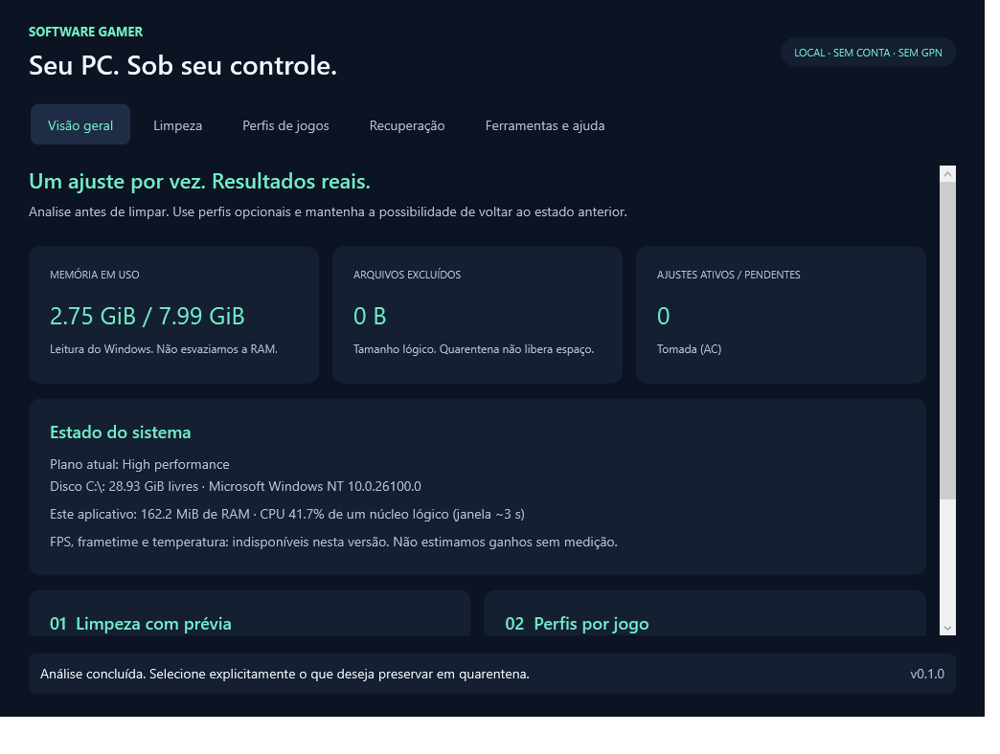

# Software Gamer

Aplicativo desktop em português para **Windows 11 x64**, com limpeza seletiva e perfis reversíveis por jogo. Funciona localmente, sem conta, telemetria, GPN ou servidores.

**Versão 0.1.0: funcional para validação.** Não representa homologação de produção nem promete aumento de FPS. Veja [limitações](docs/LIMITACOES.md) e [evidências de testes](docs/VALIDACAO.md).



Interface renderizada no runner Windows de testes; os valores exibidos pertencem a esse ambiente.

## Baixar e executar

Acesse [Releases](https://github.com/pedroisf/software-gamer/releases) e baixe:

- `SoftwareGamer-Setup-x64.exe`: instalador por usuário, com menu Iniciar e desinstalador.
- `SoftwareGamer.exe`: executável portátil com runtime .NET incluído.
- `SoftwareGamer-win-x64.zip`: pacote portátil com documentação.
- `SHA256SUMS.txt`: hashes dos binários da mesma versão.

Abra sem **Executar como administrador**. A distribuição inicial não tem assinatura digital comercial; não desative proteções do Windows para executá-la. O repositório é privado: os downloads exigem acesso à conta autorizada.

## Funcionalidades

| Área | Implementado |
|---|---|
| Dashboard | Memória do Windows, disco disponível, plano de energia, consumo do próprio app e pendências |
| Cleaner | Análise de `.tmp`/`.temp` com mais de 7 dias no Temp local; seleção explícita e proteção contra links/arquivos alterados |
| Quarentena | Até 2 GiB, sem purga automática; restauração sem sobrescrita e exclusão permanente confirmada |
| Perfis | Executável identificado por caminho/hash, prioridade AboveNormal opcional e seleção de plano existente em AC |
| Automação | Detecção de jogos cadastrados enquanto o app está aberto; um perfil ativo por vez |
| Recuperação | Journal anterior à alteração, processo observador, restauração na saída/crash e no próximo logon para energia |
| Ferramentas | Atalhos para Armazenamento, Game Mode, Capturas e Energia do Windows |
| Privacidade | Sem envio de dados; exportação manual de diagnóstico sem caminhos pessoais |

Caches de jogos e browsers, shaders, Prefetch, pagefile, limpezas de Registro e Standby List não são apagados automaticamente. Configurações padrão podem superar os ajustes opcionais.

## Código e compilação

C# / .NET 10 / WPF. Não há driver próprio, serviço privilegiado ou componente Rust, pois a rede saiu do escopo. O projeto não depende de pacotes NuGet de terceiros.

```powershell
# Windows, SDK indicado em global.json
./scripts/build.ps1 -Publish

# Ou executar manualmente
dotnet build src/SoftwareGamer.App -c Release -warnaserror
dotnet run --project tests/SoftwareGamer.Tests -c Release
dotnet run --project src/SoftwareGamer.App
```

Publicação self-contained em `artifacts/portable`. O instalador usa Inno Setup 6; o workflow [Windows build and validation](.github/workflows/windows.yml) executa testes, publica, renderiza a interface, compila o instalador e gera hashes.

## Organização

- `src/SoftwareGamer.Core`: políticas, persistência, integração Win32, Cleaner e Booster.
- `src/SoftwareGamer.App`: interface, watchdog e recuperação de logon.
- `tests/SoftwareGamer.Tests`: harness de testes com código de saída para CI, sem framework externo.
- `installer` / `scripts`: empacotamento e build reproduzível.
- [Especificação vigente](ESPECIFICACAO_TECNICA.md), [guia do usuário](docs/GUIA_DO_USUARIO.md), [arquitetura](docs/ARQUITETURA.md), [validação](docs/VALIDACAO.md).
- `docs/archive`: proposta histórica que incluía GPN; **não é o escopo atual**.

## Próximos gates

Homologação em Windows 11 físico e notebooks, acessibilidade/DPI, sessões reais de jogos/anti-cheats e assinatura comercial. Esses itens não são substituídos por uma compilação bem-sucedida. A distribuição inicial usa atualizações manuais pelo GitHub Releases.
